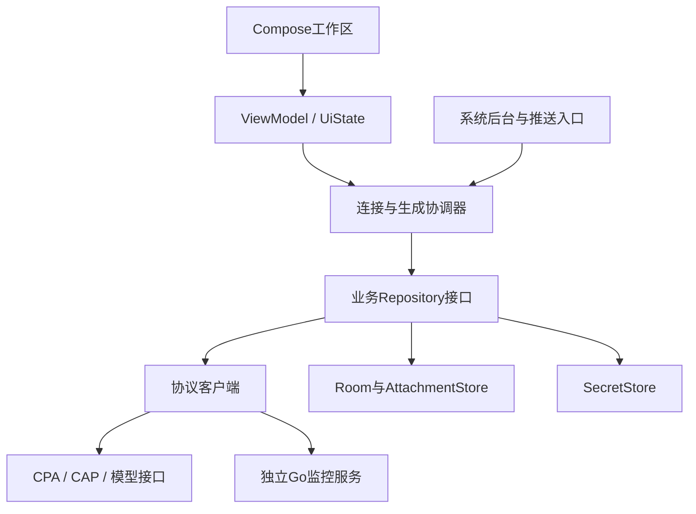

# 03 · 原生 Android 架构与状态所有权

本章描述候选目标架构，不表示代码已存在。固定来源见 [02](02-source-parity.md)；协议、聊天和平台细则见 [04](04-protocols-and-monitoring.md)、[05](05-chat-and-storage.md)、[06](06-android-platform-security.md)。

## 1. 工程原则

- 客户端全部核心能力由 Kotlin 与 Android 原生组件实现；Swift 作为行为来源，Go 服务继续在服务端运行。
- UI 从不可变状态渲染；用户事件进入 ViewModel，再调用有明确身份和生命周期的业务操作。
- 规范化模型不直接暴露服务端 DTO、Room Entity、Android Context 或密码学密钥。
- 复杂跨步骤操作抽 use case/coordinator；简单查询由 Repository 接口提供，避免为每个 getter 新建一层。
- 业务接口定义在纯 Kotlin 核心；实现由 app 组合。任何 feature 都不直接读写数据库文件、Keystore 或网络响应。
- 每项可变状态只设一个明确写入所有者。后台入口和前台入口复用同一业务规则。

## 2. 拟议模块

独立 Android 仓库的未来目录如下；此次只提交企划，未创建这些应用模块。

| 模块 | 内容 | 可以依赖 | 禁止依赖 |
| --- | --- | --- | --- |
| :app | Application/Activity、DI、路由注册、build variants | feature、data、platform、designsystem | 不能成为业务规则杂物箱 |
| :core:domain | 值对象、错误、Repository/平台接口、复杂 use case、时钟接口 | Kotlin/Coroutines | Android UI、Room、HTTP 客户端 |
| :core:protocol | wire DTO、归一化、SSE、reasoning/统计规则 | domain、序列化库 | Android Context/Compose/数据库 |
| :data | Repository、网络适配、Room、文件事务、缓存 | domain、protocol、Android数据API | feature、UI控件 |
| :platform | Keystore、通知、照片/分享、WorkManager/Glance接入 | domain、必要Android API | feature实现、任意服务器业务DTO |
| :designsystem | 颜色、排版、图表组件、状态与交互组件 | Compose/Material | 网络、凭据、业务持久化 |
| :feature:connection | CPA/监控工作区、设置 | domain、designsystem | 其他feature实现、data实现 |
| :feature:quotas | 额度总览与详情 | domain、designsystem | 直接网络和Room |
| :feature:cap | CAP各栏目和明细 | domain、designsystem | 同上 |
| :feature:diagnostics | 账号诊断 | domain、designsystem | 同上 |
| :feature:chat | 会话、消息、库、设置与输入 | domain、designsystem、经审查的渲染器 | 协议判定和磁盘格式 |
| :testing / :benchmark | fixtures、fakes、时钟、基准 | 被测公开接口 | 真实生产密钥 |

推送 provider 在 platform 内按包隔离；需要不同分发构建时再独立 :platform:push-fcm 模块。network/database/security 初期可作为 data/platform 内部包。不要为每个接口机械拆 Gradle 模块。

Hilt 只负责装配和作用域，不把容器当服务定位器传入业务。版本 catalog、schema 和协议fixtures有指定负责人。

## 3. 数据与事件路径

图中表达职责与调用关系；实现依赖仍遵守模块表的接口反转。平台广播、推送与Worker不直接修改Composable状态。

## 4. 核心对象与职责

| 对象 | 所有者与用途 |
| --- | --- |
| ServerEndpoint | 规范化HTTPS地址及反代前缀；值对象创建时校验原始输入 |
| ConnectionContext | connectionId、serverIdentifier、credentialRevision、generation；创建后不可变 |
| ConnectionSession | 唯一管理候选验证、接受连接、切换、注销和对应请求域 |
| RequestCoordinator | 同一已接受管理连接的并发、鉴权阻断、冷却和single-flight |
| Observation | 来源值与观察时间，不因读取缓存而更新 |
| ReadingOutcome | 最近操作、错误、新鲜度、未知/不可用；不混入数值事实 |
| CAPResourceState | 每资源的窗口、参数、页码、结果、loading、error和完整性 |
| ChatRepository | 会话/消息/草稿/attempt/附件引用的持久访问 |
| GenerationCoordinator | 以会话和attempt为单位的生成、取消、回退、检查点和终态 |
| MonitorIdentity | monitor server、principal/credential revision，与CPA上下文独立 |
| MonitorSubscription | 服务端订阅、lease、状态、revision、恢复/取消记录 |
| SystemProjection | 小组件/通知安全投影，仅含许可显示的最少字段 |

管理密钥、推理密钥、搜索密钥、监控令牌采用不同 SecretRef 类型，不能用裸 String 参数互换。Token、完整服务地址与用户内容不得通过默认 toString/debug 输出。

## 5. 状态所有权与取消表

| 状态/操作 | 生命周期所有者 | 取消规则 |
| --- | --- | --- |
| 连接表单草稿 | form ViewModel | 关闭/深链退出即清理秘密；失效候选不能提交 |
| 已接受CPA上下文 | application级 ConnectionSession | 更换/忘记创建新代际并取消旧业务 |
| 额度/CAP一次读取 | 连接域coordinator | 业务取消终止；单纯屏幕重组不重发 |
| 聊天一次attempt | 会话级 GenerationCoordinator | stop/编辑重发/删除/换目的地失效；切页本身不停止 |
| 聊天后台收尾 | application生命周期策略 + coordinator | 退后台检查点、最多30秒尽力、系统可提前中断 |
| 监控控制操作 | 独立monitor会话coordinator | 保留unknown与恢复句柄；CPA切换不清掉它 |
| Worker | 系统任务 + 对应Repository | 输入只含ID，执行时重新读取权限/凭据代际，不复活已忘记连接 |
| 通知打开 | app路由协调器 | 先加载持久状态，失效ID解释后回安全入口 |

collectAsStateWithLifecycle 停止收集仅意味着UI不可见，不是网络请求已经取消的证明。SavedStateHandle保留重建线索，不能当长期数据库。UI所有字段先分成持久业务事实、可恢复导航状态、临时输入和进行中任务。

任何落库/发布结果前核对 ConnectionContext 和 attempt identity。取消响应与结果同时到达时，也必须满足单次终态发布和单次完成回调。

## 6. 两类连接独立

CPA 与监控服务具有各自的目的地、身份、凭据和generation。用户更换CPA不应剥夺停止旧监控的能力；旧监控恢复句柄必须保留其原服务和授权上下文。聊天会话绑定服务器，跨服务器继续需要绑定新目的地与credential revision的确认，布尔“已确认”不足以表达此授权。

UI显示来源时通过安全展示模型脱敏；业务路由通过opaque ID关联，不能把邮箱、显示名或列表位置当主键。

## 7. 错误与结果类型

错误至少分输入、网络、DNS、LAN权限、TLS、管理鉴权、上游单账号鉴权、限流、协议、响应过大、存储、取消、generation失效、结果不明。具体协议类别在04/05中定义。

禁止把所有失败折叠成“网络异常”，也禁止直接展示服务端body。错误对象提供：

- machine kind 与可选 scope；
- 可本地化的message key；
- 可重试条件及retry deadline；
- 安全diagnostic ID；
- 是否保留旧观察；
- 是否需要用户操作；
- operation/attempt ID。

对可产生外部副作用的操作，unknown是独立状态。聊天服务未提供幂等协议时，未知结果不能自动重发。监控控制依靠版本化幂等合同解决，不借UI按钮重复点击猜测。

## 8. 数据模型与存储策略

| 内容 | 位置与策略 |
| --- | --- |
| 非秘密偏好 | DataStore；主题、显示模式、允许共享等有版本默认值 |
| 记住模式的秘密 | SecretStore；Keystore管理加密密钥，密文在受控不可备份位置 |
| 临时连接秘密 | 仅当前进程内存；不落DataStore/Room/SavedState/Worker输入，进程回收后要求重连 |
| 聊天/记忆/技能/草稿/attempt | Room，明确schema和迁移；敏感数据默认不进入系统备份 |
| 附件 | 应用私有文件；staging/引用提交/回收，详见05 |
| 额度与CAP快照 | 默认会话内；新建磁盘缓存须单独批准数据保留合同 |
| 小组件投影 | 用户已明确共享的最少快照；来源切换/关闭可清理 |
| 监控恢复记录 | 可恢复的订阅ID、控制revision与安全句柄；秘密独立引用 |
| 日志 | 结构化脱敏事件，不包含HTTP body/Authorization/用户提示词 |

Room、文件系统和Keystore不是一个原子事务。连接接受、附件引用与凭据忘记分别设计提交顺序、失败反馈和恢复，不使用“数据库事务”一词概括所有外部操作。

## 9. 原生交互规范

- 五个工作区保留独立返回栈；再次点击当前工作区的回顶/回根行为在UI规范中固定。
- compact使用单栏，宽窗口使用列表详情并列，铰链可遮挡区域不可放关键内容。
- 选中ID与会话任务不随窗口大小变化重建；route只传可序列化ID。
- quota与CAP的图形必须有同等信息的文本/表格；未知/过期状态有文字。
- 聊天自动滚动只在用户位于底部时跟随；向上阅读保持位置。
- 系统返回先关闭键盘/局部编辑/详情等当前层级，不静默丢草稿。
- 同一业务动作的loading/cancel/error/saved/unknown文案统一；错误恢复入口保持可达。

保留源项目品牌信息层级，使用Material原生行为和主题token；不把Liquid Glass等Apple材质作为兼容前置。所有新增视觉效果必须遵守减弱动画、对比度、性能和触控尺寸约束。

## 10. 共享契约与依赖治理

源fixtures以固定提交和原路径记录导入来源，并审查许可；Android可在 contracts/ 下维护一份带来源索引的语言无关用例。不得静默修改预期以让本端通过。Go/Swift差异必须先落决策再修改测试。

客户端与Go服务采用HTTP版本化合同解耦。TASK-022定义合同，TASK-023/025在服务来源仓库实现，Android只消费并在集成环境验证。不要复制Go服务形成无人负责的第二实现。

网络、序列化、渲染等依赖使用可审阅版本锁；不使用浮动latest。新增原生.so依赖时另做ABI/页大小/分发体积检查。Release优化和R8之后再次验证序列化、DI、数据库及通知入口。

## 11. 可观测性与可测试性

每次操作记录安全的本地operation ID、类型、状态、耗时、重试原因与结果类别；请求数量、取消是否传播、旧代际是否被丢弃可由合成测试观察。计费相关用量来自协议字段，不根据文字长度伪造。

注入Clock、UUID/ID provider、NetworkTransport、SecretStore、Repository、NotificationSink和LifecyclePolicy；测试使用真实边界的fakes，不把实现内部调用次数当唯一正确性证明。SSE、限流和取消优先采用受控barrier/虚拟时钟，避免靠sleep碰运气。

## 12. 架构验收

TASK-003输出模块依赖图；TASK-005/006证明身份、取消与网络边界；TASK-012/016证明数据一致性；TASK-024/026证明monitor独立域与投递；TASK-028/029证明系统重建不会破坏上述所有权。未有这些证据前，架构图只代表设计意图。

