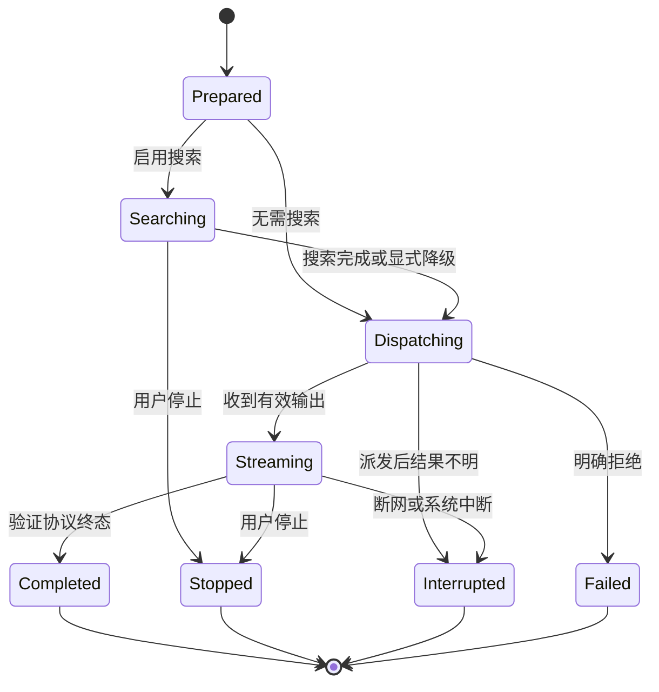

# 05 · AI 对话、流式协议与本地存储

> 状态：独立 Android 移植候选方案；待整套方案评审后成为实施基线。  
> 核验日期：2026-11-25（北京时间）。  
> 源端基线：`rinmashiro0529/cpa-quota-ios@80beea9ed251a628307825cba99290b5f246575b`。  
> 本文是新设计，未读取或沿用 Android 仓库已有企划。文中的“必须”是本候选方案的交付约束，不表示功能已经实现或测试已经通过。

## 1. 目标、证据和完整移植的定义

聊天部分交付一个原生 Kotlin/Compose 工作区：保留源端已可达的模型与密钥管理、流式对话、推理档位、图片、消息操作、续写、搜索、记忆、技能、后台尽力收尾和隐私行为；用 Android 的生命周期、数据库和系统界面实现这些能力。不能以完成一个发送文本并显示回复的页面，替代完整聊天迁移。

本文负责聊天的业务语义与存储一致性；全局模块依赖见 [03-architecture.md](03-architecture.md)，管理接口和监控服务见 [04-protocols-and-monitoring.md](04-protocols-and-monitoring.md)，Android 系统与安全约束见 [06-android-platform-security.md](06-android-platform-security.md)，实施顺序见 [07-delivery-plan.md](07-delivery-plan.md)，发布证据见 [08-verification-and-release.md](08-verification-and-release.md)。

### 1.1 已核实事实与待定代码必须分开

- 冻结主线的聊天模型包含会话、消息、图片、用量、失败、续写尝试、搜索来源、记忆、技能、设置与服务器绑定；实际聊天入口能够选择模型、修改对话设定、操作历史和消息。[S01] [S02] [S03] [S04]
- 可达协议选择是 OpenAI Chat Completions 与 Anthropic Messages。源码虽包含 `openAIResponses` 类型和构造分支，`initialProtocol` 并不把它选为当前入口；不能把 Responses 宣传为已经存在的用户能力。[S05] [S06]
- 主线没有发现 temperature、top_p、seed 的用户设置；引擎也没有显式设置这些参数。必须移植的是实际 reasoning 策略及其请求字段，不能编造一套“源端采样面板”。[S01] [S03] [S05] [S06]
- 主线使用 JSON 文件保存完整会话，附件随消息内联；启动读取全部会话。`ChatWorkspaceModel` 同时管理凭据、生成、搜索、持久化和通知，文件约 1,632 行。它提供有价值的行为参考，但不是 Android 类结构模板。[S07] [S08]
- 核验时 PR #33、#34 均未合并；#34 的 head 是 `8c17687d8a893297585da51a3e7c3c4b54153d5a`，base 是 #33 对应的 `fix/ui-test-snapshot-race` 分支。#34 提议附件外置、摘要索引、懒加载及模型拆分，其代码和 PR 自述不能算作主线完成状态，性能自述也不等于本方案测量结果。[S19] [S20]
- 已核对聊天 UI、模型和持久化中未发现面向用户的会话导出/导入入口。本文将导入/导出界定为独立增强，数据库版本迁移和数据恢复则属于本次必做工程能力。[S01] [S02] [S03] [S07]

### 1.2 必须完成的用户能力清单

下表全部进入正式范围。开发顺序可以分阶段，不能在发布时把未完成项改称“可选”来获得完整移植结论。

| ID | 必须完成的能力 | Android 端验收含义 | 源端证据 |
| --- | --- | --- | --- |
| CHAT-01 | 绑定当前已验证的 CPA 连接 | 管理密钥、推理 Key、搜索 Key 分离；切换连接后旧请求失效 | [S08] [S09] |
| CHAT-02 | 发现、选择、手动设置和移除推理 Key | 单 Key 可按源端行为选用；多 Key 由用户选择；失败、未配置、删除失败明确区分 | [S08] [S09] [S10] |
| CHAT-03 | “不记住连接” | 推理凭据只存内存；此前同服务存储凭据的移除失败必须可见 | [S08] |
| CHAT-04 | 模型目录和刷新 | 从当前推理 Key 对应目录获取；保留 `owned_by`；不存在、加载中、空目录、拒绝授权分别呈现 | [S10] |
| CHAT-05 | 新会话模型策略 | 固定模型或沿用上次选择；按服务器记忆；原模型被移除时明确处理 | [S01] [S08] [S11] |
| CHAT-06 | 每会话模型和推理档位 | automatic/off/low/medium/high/xhigh/max；显示实际降级或省略结果 | [S01] [S03] [S06] |
| CHAT-07 | 会话列表和搜索 | 新建、复用空会话、打开、重命名、删除、标题及正文搜索 | [S02] [S08] |
| CHAT-08 | 删除全部会话 | 一次确认；失败后能核对剩余记录；状态不明不能显示“已全部删除” | [S08] [S11] |
| CHAT-09 | 完整消息生命周期 | 发送、停止、重新生成、编辑并重新发送、删除消息、复制正文、加入记忆 | [S04] [S08] [S12] |
| CHAT-10 | 历史截断确认 | 编辑或重生成可能删除后续消息；校验发送条件与确认后才修改历史 | [S04] [S08] |
| CHAT-11 | 持续输出 | 正文与服务端实际给出的可见推理分别显示；正确处理 usage 和终止事件 | [S05] [S12] |
| CHAT-12 | 推理折叠交互 | 自动状态与用户手动展开/收起不相互覆盖；无实际推理文本时不伪造内容 | [S12] |
| CHAT-13 | 续写与重试 | 绑定原问题、原回复、当前模型与目的地；保留每次尝试和已生成文字 | [S08] [S13] |
| CHAT-14 | 会话内草稿 | 切页、旋转、折叠和返回不丢文字、图片及编辑态；Android 增加进程死亡恢复 | [S08] [S14] |
| CHAT-15 | 图片选择和发送 | 最多 4 张；预览、移除、异步处理、纯图片提问、历史图片预算 | [S14] [S15] |
| CHAT-16 | Markdown、代码与数学内容呈现 | 按源端渲染实际输出建立夹具；包括流式未闭合块、代码复制和长内容滚动 | [S12] [S16] |
| CHAT-17 | 静态 HTML 预览 | 保留独立预览入口、源码和复制；严格隔离脚本、网络、本地文件和导航 | [S17] [S18] [S27] |
| CHAT-18 | 五家第三方搜索 | Tavily、Brave、Exa、Serper、SerpAPI，均有独立配置及 adapter | [S21] |
| CHAT-19 | 搜索结果和失败反馈 | 显示编号来源；未配置、Key 读取失败、请求失败、零结果、搜索中断分别建模 | [S08] [S12] [S21] |
| CHAT-20 | 全局规则与会话设定 | 明确作用域、拼装顺序、保存失败；不把设置读取失败当空白设置回写 | [S03] [S11] [S15] |
| CHAT-21 | 记忆 | 新增、从消息添加、编辑、删除、置顶、使用开关；跨服务器作用域说明 | [S11] [S15] [S22] |
| CHAT-22 | 斜杠技能 | 新建、编辑、删除、建议列表、规范化命令、重复校验、执行时展开快照 | [S08] [S14] [S15] [S22] |
| CHAT-23 | 自动标题 | 可关闭；只替换仍未被用户改动的自动占位标题；旧连接任务不能写回来 | [S08] [S11] |
| CHAT-24 | 用量显示 | 单消息/会话统计、尝试次数、未知用量标记，续写不重复累计快照 | [S03] [S08] [S12] |
| CHAT-25 | 本地恢复和失败可见 | 部分输出 checkpoint、终态落盘、读取失败、保存失败、删除失败、未知状态恢复 | [S07] [S08] |
| CHAT-26 | 后台尽力收尾与通知 | 有界继续、到期中断、完成通知开关与授权、冷启动定位、无敏感锁屏内容 | [S11] [S23] |
| CHAT-27 | 跨服务器历史保护 | 旧历史发往新服务必须确认；确认绑定凭据代际；未知来源历史同样处理 | [S01] [S08] |
| CHAT-28 | 原生可访问性与自适应 | TalkBack、字体放大、键盘、分屏、折叠、返回手势和列表/详情状态保持 | [S02] [S04] [S12] [S14] |

CHAT-16 的首个开发任务必须补齐源端第三方渲染器的实际输出夹具及许可证清单。不能只因 Compose 能显示 Markdown，就宣布代码高亮、表格、数学内容和流式边界全部等价；也不能未经核验承诺源端不存在的渲染格式。

## 2. 本候选方案的架构决策

这些是本方案主动做出的默认决策。后续可以通过 ADR 变更，但变更必须写明兼容性、数据迁移、验收用例及对完整范围的影响。

| ADR | 默认决策 | 理由与变更门槛 |
| --- | --- | --- |
| CHAT-ADR-01 | Kotlin 业务实现；Compose 原生界面；按职责分离工作区与生成协调器 | 保留行为合同，避免复制 Swift 大型工作区对象；模块边界服从 03 |
| CHAT-ADR-02 | Room 存正文和关系，应用私有文件存图片，偏好按 03 的设置方案保存 | 处理历史分页、消息级写入和附件复用；文件与数据库一致性见第 7 节 |
| CHAT-ADR-03 | 显式协议 adapter + 有界兼容策略 | 不把第三方 SDK 默认 EOF、重试和缓存行为当业务合同 |
| CHAT-ADR-04 | 生成从页面生命周期分离；每会话最多一个进行中的用户生成 | 旋转/折叠/导航不重新计费；同时打开不同会话允许受全局并发预算控制的任务 |
| CHAT-ADR-05 | 自动重试只用于已分类的、未消费输出的协议兼容拒绝 | 网络断线和结果不明不自动重发；完整规则见第 4 节 |
| CHAT-ADR-06 | 默认退后台立即 checkpoint，并在进程仍获运行时最多 30 秒尽力收尾 | 与源端有界尽力语义对齐；不承诺 Android 保活 30 秒，不引入无限前台服务 |
| CHAT-ADR-07 | 原生 Markdown/代码/数学渲染；HTML 仅静态隔离预览 | HTML 不是应用主体，且不执行模型生成脚本 |
| CHAT-ADR-08 | 全局规则、记忆和搜索设置保留工作区全局语义，并明确披露作用域 | 不静默把已有全局内容改为每服务器隔离；跨服务器发送提示说明会附加的全局上下文 |
| CHAT-ADR-09 | 初版保留标题/正文“包含”搜索语义，不用 token 全文索引替换后宣称完全相同 | 中文子串和任意正文片段必须可查；索引优化不能改变可见结果合同 |
| CHAT-ADR-10 | 主线行为是对照基线，#34 仅作待审技术参考 | Android 独立采用附件外置/懒加载，不等待或假定 #34 已合并 |

主线不足不会被机械保留：全量读取、每次写入重编码图片、只有内存草稿和过大的状态对象应在 Android 实现中改善。改进必须保留错误与数据保护语义，不能用“简化”删除失败提示、续写信息或跨服务确认。

## 3. Kotlin 组件与依赖方向

### 3.1 组件职责

| 组件 | 负责 | 明确不负责 |
| --- | --- | --- |
| `ChatListViewModel` | 列表、搜索、分页、选择、重命名/删除 intent | 持有整个历史正文、HTTP 解析、附件编码 |
| `ConversationViewModel` | 当前页面状态、草稿、滚动/编辑/折叠状态、用户 intent | 直接发 POST、调用 KeyStore、拥有生成任务唯一生命周期 |
| `ChatSettingsViewModel` / `ChatLibraryViewModel` | 配置、密钥状态、模型策略、记忆和技能编辑 | 把异常吞成空配置、无条件保存读失败的默认值 |
| `GenerationCoordinator` | 生成状态机、会话互斥、attempt、取消、搜索和生成串联、终态提交 | Compose、Activity、实际 HTTP 序列化 |
| `ConversationRepository` | Room 事务、摘要/正文查询、删除、草稿、版本与恢复 | 默认重发网络请求、把附件二进制塞进消息行 |
| `ChatTransport` | 流式/一次性推理的统一接口与生命周期 | 修改会话数据库或 UI |
| `OpenAiChatAdapter` / `AnthropicMessagesAdapter` | wire DTO、SSE、完成标记、错误与用量映射 | 自行无界重试或隐藏实际协议 |
| `ReasoningPolicy` | 纯函数：请求档位 + 模型资料 + 能力 profile → wire plan | 请求网络、写 UI、拿系统当前时间 |
| `CapabilityRegistry` | 连接/模型/凭据代际内的兼容信息 | 把旧拒绝写入新会话、把别名猜测视为服务端能力证明 |
| `PromptAssembler` / `HistoryBudgeter` | 本轮冻结指令、技能展开、历史选择、图片预算、续写上下文 | 读取全局可变状态后在重试中悄悄改变输入 |
| `SearchRepository` | 五 provider adapter、搜索快照、结果校验和失败分类 | 搜索结果执行、把搜索 Key 作为推理 Key |
| `AttachmentStore` | 受控导入、编码、缩略图、引用、回收和恢复 | 暴露任意文件路径、依赖外部 Uri 永久有效 |
| `ChatCredentialResolver` | 当前连接的推理 Key 发现/选择/短时取用 | 明文 Key 进入 SavedState/Room/日志 |
| `CompletionNotifier` | 固定通知文案、授权查询、幂等去重、会话路由 | 把会话标题或回复正文放到锁屏 |
| `BackgroundGenerationPolicy` | 前后台状态、30 秒软时限、到期取消和 checkpoint | 承诺 OS 执行额度、用周期 Worker 恢复计费请求 |
| `ChatRecoveryCoordinator` | 启动时对未完成操作、待删附件和通知记录作核对 | 推测上游完成、自动把未知请求重发 |

业务层向数据/平台接口编程，真实 adapter 在应用装配处注入。协议规则和状态机使用可注入时钟、ID 工厂、调度器与故障脚本，避免依赖真实等待来测试竞态。

### 3.2 最小内部合同

以下是设计形状，不是可直接编译的 SDK 声明；实际命名服从 03。

```kotlin
data class GenerationIdentity(
    val connectionId: ConnectionId,
    val credentialRevision: Long,
    val conversationId: ConversationId,
    val assistantMessageId: MessageId,
    val attemptId: AttemptId,
)

interface ChatTransport {
    fun stream(request: FrozenChatRequest): Flow<ChatEvent>
    suspend fun complete(request: FrozenChatRequest): CompletionResult
}

sealed interface ChatEvent {
    data class Snapshot(val sequence: Long, val text: String, val reasoning: String?) : ChatEvent
    data class Usage(val value: AttemptUsage) : ChatEvent
    data class Resolution(val value: ReasoningResolution) : ChatEvent
    data class Completed(val evidence: CompletionEvidence) : ChatEvent
}
```

原始 adapter 可以消费 delta，但向 coordinator 输出的文本合同必须明确为**累计快照**，与源端 `ChatEngine` 一致；不能让某 adapter 输出 delta、某 adapter 输出 snapshot 而让上层猜测。[S24] `Flow` 的正常结束本身不是完成证据；只有 adapter 验证协议终态后发出 `Completed`，协调器才可提交 `complete`。

页面观察不可变 UI state；DAO 使用异步查询/Flow。观察消息表可能因表内其他行变化重新执行，必须做窄查询、摘要分离和结果去重，不能以“用了 Flow”证明没有全历史重算。[A01]

## 4. 生成、续写、重试和未知结果

### 4.1 三种状态必须分开

1. **业务进度**：准备、搜索、生成、完成、停止、中断、失败。
2. **远端结果确定性**：确定尚未派发、明确拒绝、可能已处理、收到部分输出、收到协议终态。
3. **本地持久化**：已保存、待保存、保存失败、需要恢复核对。

例如：服务器返回了完整回复，但最后一次数据库写失败，界面应显示“回复已生成，尚未成功保存”；请求发出后断网且没有文字，应该显示“未收到完整结果，服务端可能已处理”，不能显示“没有产生请求/费用”。三种状态分别建模，避免用一个 `isLoading` 或错误字符串承载全部含义。



终态后仍有“提交数据库”和“可能投递完成通知”的步骤；它们不重新进入网络生成。用户点击续写/重新生成创建新 attempt，旧 attempt 记录不改写为新请求。

### 4.2 派发与并发纪律

- 同一会话的用户生成通过数据库中的活动操作记录与进程内协调器共同保护；连续点击发送只能建立一个进行中的 attempt。不同会话受全局并发预算限制，排队期间提供可取消状态。
- 发送前在事务中保存用户消息、assistant 占位、冻结输入引用与 `prepared` attempt。若存储失败，不先发网络再假装历史已保存。
- 发送前写 `dispatch_intent`。崩溃可能发生在写入后、真实 HTTP 前；恢复时宁可保守标记未知，也不根据没有响应推断“没有发送”。HTTP 请求与本地事务无法原子提交。
- 所有后续事件包含完整 `GenerationIdentity` 和单调递增序号。更新必须确认会话仍存在、attempt 仍是活动操作、连接与凭据代际仍相同、事件序号不倒退。
- 取消必须传到真实 HTTP call 并关闭响应体；在调用链任一层取消时都不把取消包装为可重试网络异常。
- 用户停止只表示客户端停止接收并请求本地取消。除非上游协议明确提供且确认取消，不宣称服务器已停止计算或不会计费。
- 数据库操作记录使用应用启动实例标识；新进程发现前一实例留下的进行中 attempt，恢复为中断/未知并保留 checkpoint，**不自动重新发推理请求**。
- 轮转屏幕、调整窗口和跳到另一页只重建观察者；不能触发第二个 `stream()`。`ViewModel` 能应对配置变化，但不会单独解决进程死亡；持久业务数据由 Room/文件恢复。[A02]

### 4.3 自动兼容回退的准入表

主线有最多 6 次兼容尝试的预算，并禁止在正文、可见推理或用量已交付后回退；200 解码错误不自动改协议，Anthropic 授权回退的缓存仅在备用 OpenAI 请求成功后更新。[S05] [S06] [S25]

Android 按以下规则实现，并在审阅中逐条核对真实 wire 请求计数：

| 情形 | 自动行为 | 用户可见结果 |
| --- | --- | --- |
| 本地请求校验失败，未派发 | 不发请求；保留输入 | 明确缺少 Key、模型或输入 |
| 已识别的 reasoning 参数拒绝，未交付正文/推理/usage，且错误分类符合合同 | 选择严格不同的下一 wire plan；总请求次数不超过 6 | 记录请求过的 plan 与最终档位 |
| 已识别的 Anthropic endpoint 不支持或主线特定授权兼容分支 | 仅按经过测试的分类进入备用协议；不泛化所有 401/404 | 成功后标记实际协议；失败保留原授权原因 |
| HTTP 200 但 JSON/SSE 解码失败 | 不自动换协议、不重发 | 解析失败，必要时标记远端结果未知 |
| 超时、TCP 中断、进程被杀，不能证明服务端没有执行 | 不自动重发 | 中断/未知；保留输入和已收内容，由用户重试或续写 |
| 已收到任何正文、可见推理或 usage 后失败 | 禁止自动兼容回退 | 保留同一次尝试的内容与用量，提供恢复操作 |
| 429 | 记录 Retry-After 和冷却，不由通用拦截器重复 POST | 显示等待与下次操作时间；用户稍后重试 |
| 5xx、TLS、重定向、安全校验失败 | 不作协议猜测或绕过证书 | 分类错误及可执行下一步 |

“还没有文字”不是自动重试的充分条件。每次兼容请求都可能有远端副作用；只有明确拒绝、零消费输出且已核验的兼容分支可进入有限回退。不得用 HTTP 客户端的透明 POST retry、Worker retry 或 SDK 默认重试绕过这一规则。

能力缓存以规范化连接身份、模型 ID 和凭据代际为边界；连接切换、Key 替换和显式重置使旧回执失效。URL 规范化不能把区分大小写的路径或原始百分号编码错误改写；连接规范见 04。未知模型的名称规则只能是首次尝试启发式，不能在 UI 声称已经证明能力。

### 4.4 SSE 和用量合同

- OpenAI 使用 `[DONE]` 完成信号；Anthropic 必须解析顶层 `type: message_stop`，正文出现同样字符串不算完成。无完成信号的 EOF 是中断。[S05] [S25]
- 支持任意网络分块、跨 chunk 的 UTF-8、多行 `data:`、CR/LF/CRLF，以及主线支持的末尾事件收尾。事件大小有显式上限；超限必须失败并标记，不静默截断后显示完整成功。
- usage 在同一 wire 请求中按快照覆盖，而非逐事件累加；不同明确 attempt 再累计。缺失 usage 是未知，不能转成确定的零。兼容尝试与用户重新发起的 attempt 都能追溯，但不要把多次内部分支数冒充用户重试次数。
- 输入/输出/推理 token 分开保存；服务端只给推理 token 数时不能据此编造推理文本。[S05] [S12] [S26]
- 可见 reasoning 只来自服务端实际返回字段；不推断或重构未提供的内部推理。显示折叠状态服从用户最近操作。

### 4.5 续写、重新生成和编辑

**续写**必须绑定 `conversationId + questionId + assistantMessageId + attemptCount + modelId + connectionId + credentialRevision`。点击时、异步搜索结束时和网络派发前重复验证；更换模型或服务器需要相应确认。[S08] [S13]

完整继承以下细节：

1. 无正文的中断回复执行原轮重试；已有正文的中断回复构造接续上下文，而非把相同用户消息追加第二次。
2. 保留原轮技能展开与搜索查询；技能后来被编辑不能改变已经授权的请求内容。搜索已经完成且零结果，与搜索未完成不同。
3. 有效续写复用原搜索来源；搜索阶段被中断的空重试可以重新搜索，但停止后不得继续发推理请求。
4. 优先保留触发问题及未完成回复，先舍弃更早轮次；为超长回复保留必要尾部与代码围栏提示。展示/保存原文不因上下文裁剪而改变。[S13] [S15]
5. 只消除足够长的完整原文重放或实际发送节选的完整重放；不删除部分尾部匹配，不 trim 原文，不按模糊相似度去重。
6. 开头尚不能判定是重放还是新内容的字节放入 `pendingContinuation`。停止或进程死亡时保留可审计记录，并按源端规则不把未确认重放附加为新正文；成功时按边界算法提交。
7. 只重复旧正文而没有新增内容时显示“未生成新的内容”；保留这次尝试与可能返回的 usage，不能标为新增回复成功。
8. 重新生成/编辑重发先校验 Key、模型、父消息、跨服务器确认和当前并发状态，再在事务中截断历史并建立新 attempt。校验失败不破坏后续消息。
9. 单条消息删除要处理父子关系、展开快照、附件引用和当前操作；不能让已删除问题的派生提示词通过下一次续写悄悄重新出现。

## 5. 模型、上下文、搜索和个人内容

### 5.1 凭据与模型发现

推理 Key 发现使用管理凭据读取 `/v0/management/api-keys`；源码在 `endpointUnavailable` 时回退 `/v8/management/config/access/api-keys`。该分类实际包括 404 和 501，不能只照 README 的 404 文案写测试。两个入口均不可用表示无可发现列表，不代表手动推理 Key 不可用；401/403 不触发这类协议回退。[S09]

单 Key 自动选用、多 Key 待选择、手动 Key、已保存 Key 与移除失败分别建模；屏幕显示脱敏 hint。`/v1/models` 使用推理 Key，不发送管理密钥。模型刷新返回当前 Key 未授权时，旧目录可以作为可见缓存，但不能据此授权发送；迟到的旧目录也不能把新 Key 标为有效。[S08] [S10]

连接“不记住”只控制凭据持久化，不应暗示对话和草稿不会本地保存。连接页与聊天设置要明确说明这两个选择；相关隐私文案在 06 审阅。

### 5.2 推理与请求参数

| 内容 | 源端实际合同 | Android 决策 |
| --- | --- | --- |
| reasoning 档位 | automatic、off、low、medium、high、xhigh、max | 完整保留并按服务器/模型记忆选择 |
| OpenAI 流式 usage | 显式 `stream_options.include_usage = true` | 保留；不能依赖 SDK 只为官方域名打开的默认行为 |
| OpenAI reasoning | 通过 `reasoning_effort` 发送；automatic 不强行设置 | 同合同；记录 requested/applied/outcome |
| off 的兼容阶梯 | none → minimal → low，必要时省略 | 显示实际强制推理/降级；不能仍显示“已完全关闭” |
| xhigh/max 等阶梯 | 逐级下降；可利用错误给出的允许值 | 纯函数 + fixture；有限请求预算下可直接跳到允许值 |
| Anthropic thinking | adaptive 或 budget，依赖模型启发式及明确拒绝 | 双分支都做，防止 adaptive/budget 之间循环 |
| Anthropic budget | low 2,048；medium 8,192；high 16,384；xhigh 24,576；max 32,768 | 这是冻结源码策略，不是对模型厂商永久能力的断言 |
| Anthropic max_tokens | 默认 16,384；预算需留输出空间；拒绝后按已核验上限收敛 | 保留 source fixtures，实际 wire 值和降级可追溯 |
| temperature/top_p/seed | 已核对用户入口与引擎未显式提供 | 基线不新增伪对等设置；以后单独 ADR |
| Responses | 存在内部类型，当前初始路由不可达 | 不作为完整源端对等要求，也不对外声称已支持 |

上述数值和分支取自冻结源码 [S05] [S06]，不代表 2026-11-25 所有服务商均接受它们。实施时以 CPA 实际兼容行为和脱敏合同夹具验收，不能为“自动兼容”在生产上盲目枚举参数。

### 5.3 冻结上下文与历史预算

源端指令顺序为当前日期、全局规则、启用的记忆、本对话设定；记忆置顶影响排序而非“只有置顶才使用”。技能展开保留用户看到的原消息，模型请求使用展开后的提示词；较早历史按完整轮次保留，当前默认预算是约 60,000 个 Swift 字符，历史图片最多来自最近 2 条含图用户消息。[S15]

Android 的每次用户 attempt 冻结日期/时区、规则版本、记忆内容、技能展开、搜索查询、所选历史及附件引用。兼容回退只改 wire plan，不重新读取可变设置和当前时间。自动标题使用独立的内部操作，不能混进正文 attempt，也不能在连接变化后继续调用旧 Key。

默认继承 60,000 字符和最近 2 条含图历史消息的产品预算，最终字符单位按第 8 节固定；它不等于 token 上限。界面明确“本轮省略了较早的 N 条消息”。服务器真实上下文超限返回明确错误；以后模型能力目录/token 估算是可变更优化，不能假装当前已经有精确计数器。

当设置读取失败、记忆读取失败或记忆开关无法确认时，不把记忆带入请求；保留本地数据并提示重试。禁止用默认开启记忆覆盖一个读失败的关闭设置。[S08] [S26]

### 5.4 五家搜索 provider

| Provider | 冻结源码的 endpoint | 凭据方式 | 对等要求 |
| --- | --- | --- | --- |
| Tavily | `https://api.tavily.com/search` | Bearer header | query/max_results；结果解析与无结果 |
| Brave | `https://api.search.brave.com/res/v1/web/search` | `X-Subscription-Token` | q/count；结果解析与无结果 |
| Exa | `https://api.exa.ai/search` | Bearer header | query/numResults/contents；结果解析 |
| Serper | `https://google.serper.dev/search` | `X-API-KEY` | q/num；organic 结果 |
| SerpAPI | `https://serpapi.com/search.json` | `api_key` query 参数 | engine/q/num；organic_results；特别屏蔽 URL 日志 |

表中是项目适配的接口形状，实施前需在 provider 官方当前合同上复核，不据此猜测价格或配额。源端每家最多取 5 条候选结果。[S21]

必须做到：

- 五家都具备配置、密钥保存/删除、失败反馈和离线 fixture；不能只完成一家后把其他四家放进“以后扩展”。真实服务验证应使用受控授权账户和预算，见 08。
- `absent / present / unknown` 区分密钥缺失与安全存储读取失败。主线 `performSearch` 的 `try?` 会把部分读失败归为未配置；Android 采用明确分类，不复制这一不足；#34 的相关修正仅是独立参考。[S08] [S20]
- 搜索词发送给所选第三方；结果片段再发送给当前推理服务器。SerpAPI 的 query Key 进入请求 URL，必须在设置中明确披露并对 URL/崩溃日志脱敏。
- 默认维持源端行为：搜索不可用时可以继续模型回答，但必须带“未执行搜索/搜索失败”的可见标记，不能显示联网成功。用户停止搜索则停止本轮，不继续推理。
- URL 必须解析并验证 scheme 和 host，只允许 http/https 来源链接；点击在受控外部导航中打开，不把 `intent:`、`javascript:`、`file:`、`content:` 当搜索结果链接执行。
- 引用来源保存 title/url/snippet/ordinal 和结果快照。结果是非可信资料，不成为系统指令；分隔符只帮助说明边界，不构成消除提示注入的保证。
- 所有搜索 client 独立于 CPA 请求拦截器，拒绝重定向，禁用凭据透传、cookie 和敏感缓存。后续若允许任何重定向须另作安全 ADR。

### 5.5 记忆、技能、标题与用量

完整实现记忆 CRUD/置顶/开关与消息“加入记忆”；技能 CRUD/建议/重复命令校验及默认技能。规范化仅用于命令匹配，不能改写技能正文。重复校验既在 UI，也在持久化事务中执行，避免两个编辑窗口同时保存冲突命令。

全局规则与记忆目前是跨服务器工作区全局数据。[S01] [S15] Android 保留这一语义，但在全局内容编辑页及跨服务器确认中清楚说明。服务器绑定确认至少描述历史消息数、图片数、目的地址及附加全局上下文；确认 token 绑定连接和凭据代际，不存真实 Key。不能用一个持久 `confirmed=true` 永久绕过后续目的地变化。

自动标题仅覆盖仍与自动占位标题相同的值；用户改名后晚到结果丢弃。标题生成失败不影响正文完成；可关闭；涉及独立推理请求时在隐私/请求说明中可见。用量显示保留未知项，不能把未返回 usage 的请求计为确定零。[S08] [S12]

## 6. Room 数据模型和持久化纪律

### 6.1 建议初始 schema

所有时间字段的内部单位为 UTC Unix 毫秒，外部交换使用明确的带时区格式；具体迁移转换见第 8 节。ID 使用不透明 UUID；网络模型 ID、source URL 等均不作为文件路径。表名是逻辑建议，实际拆分服从 03。

| 实体 | 核心字段 | 约束与用途 |
| --- | --- | --- |
| `conversation` | id、server_binding、title、title_origin、model_id、system_prompt、reasoning_effort、web_search_enabled、created_at、activity_at、metadata_revision、deleted_at | 摘要可直接查询；改标题/设定不因每次打字改变活跃排序；删除建立 tombstone |
| `message` | id、conversation_id、ordinal、role、text、visible_reasoning、status、failure_code、reply_to_id、created_at、last_checkpoint_seq、content_revision | `(conversation_id, ordinal)` 唯一；正文和 reasoning 分离；稳定列表 key |
| `generation_attempt` | id、message_id、attempt_index、connection_id、credential_revision、requested_model、requested_reasoning、effective_protocol、effective_reasoning、state、dispatch_state、boot_id、started_at、ended_at | 一次用户尝试可含有限 wire tries；记录远端结果确定性，不存明文 Key |
| `wire_try` | id、attempt_id、try_index、plan_fingerprint、dispatch_state、http_status、completion_evidence、usage_known、usage_fields、failure_code | 兼容回退计数、未知请求与成本解释；指纹排除密钥与完整用户内容 |
| `request_snapshot` | attempt_id、schema_version、effective_instructions、expanded_prompt、search_query、selected_message_ids、attachment_ids、history_budget_version、omitted_count | 固定本轮语义；敏感内容按聊天数据保护；不复制图片二进制 |
| `search_snapshot` | id、attempt_id、provider、status、query、completed_at、failure_code | completed-empty 与 interrupted 不混用 |
| `search_source` | snapshot_id、ordinal、title、validated_url、snippet | 稳定来源编号；不存 provider Key |
| `message_continuation` | message_id、base_revision、pending_bytes、boundary_version、sent_excerpt | 保存未确定前缀与算法版本；不混同已展示正文 |
| `attachment` | id、storage_name、mime、byte_count、width、height、sha256、state、created_at | 文件名受控；ready 才可用于请求；内容散列用于完整性，非身份授权 |
| `message_attachment` / `draft_attachment` | owner_id、attachment_id、ordinal | 通过关系判断引用；顺序稳定，不能只依赖易失内存引用计数 |
| `draft` | conversation_id、mode、editing_message_id、text、revision、updated_at | 草稿按会话/编辑模式隔离；发送成功建立本地 attempt 后才清除对应 revision |
| `memory` | id、text、pinned、created_at、revision | 全局作用域可见；删除和保存失败明确 |
| `skill` | id、command_original、command_normalized、title、prompt、revision | normalized command 唯一；正文完整保留 |
| `model_preference` | connection_id、model_id、last_reasoning、last_selected_at | 不把服务器 A 选择污染 B；不记住连接按临时策略处理 |
| `pending_delete` | operation_id、target_type、target_id、expected_revision、state | 删除失败/中断恢复；防止旧保存把内容复活 |
| `notification_receipt` | completion_id、conversation_id、state、created_at | 完成后通知去重；通知仅带不透明本地 ID |

客户端密钥、管理密钥、搜索密钥和推送凭据不进入上述表、`Bundle`、`SavedStateHandle` 或导出文件。凭据具体保护方案见 06。Room 不自动等于加密数据库，应用私有目录也不等于所有攻击模型下的保密；威胁模型和备份策略在 06 中明确。

### 6.2 写入协议

- 网络输出先进入当前 attempt 的内存聚合器。当前回复正文的 UI 更新合并到合理节奏，不能每 token 更新全局工作区。
- 首个持久用户消息与占位、状态变化、停止、完成、进入后台立即提交；连续输出默认最长每 2 秒 checkpoint 一次，继承源端量级。该间隔是正常运行时目标，不是突然断电下绝对不丢字的保证。[S08]
- 同一消息使用版本/序号条件更新，旧 checkpoint 返回后不能覆盖新终态。数据库事务按消息或操作串行，避免一个会话大写入无限阻塞全部会话。
- 终态持久化成功后才发送完成通知。终态保存失败保留内存结果、已有 checkpoint 和重试入口，不显示“保存成功”，也不为修复存储而再次调用模型。
- 写入调度器合并尚未执行的相同消息中间快照，但不得合并丢失终态、删除、attempt 边界或用户编辑。
- 读取失败不得自动用空数组覆盖数据库；损坏记录进入可见隔离/恢复状态，其他正常会话仍可读。源端忽略某个坏 JSON 的做法不能成为 Android 静默隐藏数据的理由。[S07]
- 撤销连接只使旧网络操作和凭据失效，不默认删除本地历史；用户删除才进入删除协议。

### 6.3 查询与搜索

会话列表读取 `conversation` 摘要和轻量最后消息投影；打开会话后分页读取消息。正在生成的最后一条单独观察；历史 Markdown/数学排版缓存按 `messageId + contentRevision + rendererVersion` 键控。全文搜索不读取附件，不触发图片解码。[A01]

不能直接以 SQLite FTS 的分词结果替换源端的标题/正文包含搜索，尤其中文子串、符号、代码片段未必构成完整 token。默认使用版本化的搜索投影、正确转义 `%`/`_` 的包含匹配和后台查询；容量达到性能门槛后可加 n-gram 候选索引，但最终仍须验证同一包含语义。搜索归一化仅用于投影，不改正文；Locale、大小写、组合字符的结果由 fixture 固定。150 毫秒左右的输入去抖是候选交互值，清空立即生效，不能以去抖隐藏查询错误。

### 6.4 删除与恢复

删除开始先使相关活动 attempt 失效/取消，再在事务中建立 tombstone 并解除消息、草稿和附件引用；文件删除随后进行。所有迟到写入检查 tombstone 和版本，防止旧快照复活被删会话。

单条/全部删除有 `pending / committed / failed / unknown` 结果；进程重启后根据数据库、文件与操作记录核对。数据库逻辑删除成功但附件清理失败时，界面不能再展示会话，却必须让存储管理和重试队列知道仍有待清理文件；不宣称所有字节已从设备物理介质不可恢复地抹除。清理默认只操作本应用生成且可验证的文件名。

## 7. AttachmentStore：图片和崩溃一致性

### 7.1 图片输入合同

源端最多 4 张，最长边缩放至 1,536 像素，以 JPEG 质量 0.8 重新编码；处理在非主线程执行。[S14] Android 保留用户可见的四图能力、方向正确的预览与发送、异步处理、可取消、纯图片提问和历史图片预算。

候选 Android 资源预算为：每个源文件最多 32 MiB、声明像素数最多 100 MP、解码前读取尺寸并采样、规范化输出最长边 1,536、单个规范化输出最多 4 MiB。这些是新的资源保护默认值，不是源端已有承诺；可通过 ADR 调整，必须用目标低内存设备验证并对超限给出明确反馈。JPEG 字节不要求与 UIKit 完全相同，但方向、可见内容、比例和实际请求 MIME 必须正确。透明区域合成色明确固定并列入视觉夹具。

照片选择使用系统选择器及必要的 Uri 权限；在用户选择后复制到受控私有暂存区，不能依赖第三方 content Uri 永久可读。重命名、扩展名和 provider MIME 均不可信；以受支持解码器验证内容，拒绝超限、损坏和伪装类型。位置等不必要元数据不进入发送文件；处理结果、删除和授权失败均可见。

### 7.2 文件与数据库不共享事务

采用“不可变文件 + 数据库引用 + 可恢复回收”协议。内容变更创建新 attachment ID，不原地覆盖已被消息引用的文件。

| 步骤 | 动作 | 崩溃后的可恢复状态 |
| --- | --- | --- |
| A1 | 生成不透明 ID 和受控文件名；创建带 operation ID 的导入记录 | 无文件则可安全清理 staging 记录 |
| A2 | 流式复制源文件到同一文件系统的 staging；限字节、验尺寸/格式、处理取消 | 不完整临时文件不被查询和发送 |
| A3 | 采样解码、方向修正、重编码；计算字节数与 SHA-256 | 仍只在 staging，失败不影响已有消息 |
| A4 | 完成写入并按实现支持刷新；原子重命名到最终受控路径 | 最终文件存在而数据库尚无引用，属于可核对孤儿 |
| A5 | Room 事务把 attachment 标为 ready 并关联到对应草稿 revision | 数据库提交后文件应存在；启动恢复验证缺失/损坏 |
| A6 | 发送准备事务把草稿附件关联到用户消息，保存 attempt，再清除已消费草稿 revision | 未派发前已保存本轮输入；迟到导入不追加到已消费草稿 |
| A7 | 移除消息/草稿时事务解除引用，标记 `gc_pending` | 文件仍在但不可继续发送；可恢复删除 |
| A8 | 回收器重新核对所有关系和活动操作，再删除无引用文件并结束记录 | 文件不存在但待删记录仍在时幂等收尾 |

数据库只保存受控文件名，不接受绝对路径或用户提供路径；阻止 `..`、分隔符、符号链接逃逸和不在根目录内的规范化结果。引用缺失文件必须显示“附件不可用”及恢复操作，不能悄悄用空图、别的图或继续声称原图已发送。

回收必须遵守：活动导入、待提交引用、草稿、已保存消息及正在构造的请求都能建立可核对租约/引用；只回收经确认无引用且不在活动操作中的文件。启动清理按 operation 状态和保守年龄窗口进行，不用“目录里数据库查不到的都立即删”的规则。

普通原子写和 rename 不能单独证明突然断电下绝对一致；应通过故障注入覆盖每个边界，并把可恢复状态定义清楚。附件目录、缩略图、数据库备份和 FileProvider 暴露规则与 06 保持一致。

## 8. 版本迁移、Unicode 与可携性

### 8.1 Android 数据库升级

- 每个正式 schema 发布都有正向迁移、旧版本 fixture、迁移失败保留原数据的策略和回归记录；禁止破坏性迁移替代用户数据迁移。
- 迁移默认离线本地完成，不上传会话、不请求模型、不读生产 Key；阶段性迁移需 operation journal 支持重入。
- 附件迁移要先准备新文件、验证摘要，再提交新引用；未提交前保持旧文件。崩溃恢复和垃圾回收使用同一协议。
- 未知 enum/未来字段采取可读保留或明确不支持，不能悄悄丢状态后宣布兼容；部分损坏不清空整个库。
- 应用降级不承诺任意旧 APK 直接打开新 schema；发布方案必须说明最低可读版本、数据保留和回滚路径。

### 8.2 iOS 历史迁移的边界

完整功能迁移不意味着 Android 可以直接读取 iOS 私有沙盒。当前源端没有已核实的用户导出入口；必须明确“已有对话是否能转移”是独立数据迁移能力，而不是凭登录同一 CPA 自动同步。当前 CPA 聊天实现是本地历史，服务器模型接口不等于历史同步接口。[S01] [S07]

新增的导入/导出若进入实施范围，应另立 ADR 并标为 Android 增强：定义 `manifest.json + conversations/messages + attachments/` 的版本化交换包，使用受控文件名、SHA-256、显式日期/单位、无密钥和无通知 token；提供预检、冲突预览、容量限制、事务导入与完整失败报告。不能把直接复制当前 Swift Codable 文件当稳定跨平台合同。导出包含用户内容，保存位置与分享对象须由用户明确选择。

本次必做的是 Android schema 迁移及为其准备的内部 fixture/import harness；用户级跨平台导入导出不伪装为源端已有功能，也不替代 CHAT-01 至 CHAT-28。

### 8.3 明确 Unicode 和序列化合同

源端历史预算使用 Swift `String.count`，续写边界使用 UTF-8 字节，默认 JSON 编码器又未声明一份跨平台交换 schema。[S07] [S13] [S15] Android 不得机械地把所有计数替换成 Kotlin `String.length`。

固定以下合同并建立双方黄金 fixture：

| 项目 | 必须明确的规则 |
| --- | --- |
| SSE 输入 | 字节流增量 UTF-8 解码；跨 chunk 多字节不产生替换字符；非法编码显式失败 |
| 续写去重 | 对保存原文与模型输出的 UTF-8 边界按算法比较；不 Unicode 归一化、不 trim |
| 历史预算 | `historyBudgetVersion` 指明字符单位；使用经 fixture 验证的扩展字素簇计数以对齐源端用户字符预算；不得把 60,000 误写为 token |
| 截取标题/节选 | 不切断代理对、组合字符或 emoji 序列；中文、ZWJ emoji、重音、CRLF 都有夹具 |
| 命令/搜索规范化 | 明确大小写和 Locale；仅改匹配键，不改用户保存的正文 |
| 日期 | Android 内部 UTC Unix 毫秒；交换格式显式 offset/单位；iOS 格式通过真实序列化 fixture 验证转换，不能按数字猜 epoch |
| enum 与缺字段 | 明确 wire name、unknown 策略、旧字段默认和可空语义；`null`、缺失、空数组不一概混用 |
| usage | 非负整数、溢出检查、known/unknown；未知不当零，跨尝试累积不丢精度 |
| URL | scheme/host 规范化与原始编码 path 分开；任何 canonical key 变更必须迁移绑定关系 |

若不同系统 ICU/Unicode 版本导致字素切分差异，必须在兼容层固定相关规则或明确记录边界变化；不能把某台模拟器上“看起来一样”当跨版本合同。

## 9. 原生界面、渲染与 HTML 隔离

### 9.1 页面与交互

紧凑窗口使用会话列表 → 会话详情；宽窗口使用列表/详情双栏，保持同一会话 ID、输入草稿、选中模型、滚动锚点、编辑模式与推理展开状态。铰链、安全区、输入法和导航方案服从 03/06，不由聊天页自行创造第二套导航栈。

流式输出期间用户仍可滚动历史；只有用户已处于底部跟随模式时自动跟随，不在每个 token 强制滚到底部。顶部模型选择、底部发送/停止、四图缩略图、Reasoning 选择与键盘组合不因字体放大或窗口变化重建业务任务。TalkBack 对状态变化作有界播报，不逐 token 抢读；各操作有明确角色、可达焦点和足够触控区。

取消编辑不破坏原消息；编辑提交才经过截断确认。复制保留原始正文/代码，不复制 UI 文案；“已复制”反馈不会覆盖错误提示。会话重命名与设置编辑采用草稿提交，避免每次按键写库并重排列表。[S03] [S12]

### 9.2 原生 Markdown、代码与数学呈现

采用经许可证审查的原生渲染组件组合或可测试的 Compose renderer，隔离在 `ChatContentRenderer` 接口内。依赖版本与许可证在 03/08 锁定，不能因某库名称类似 SwiftStreamingMarkdown 就判定能力等价。

源端实际渲染输出需形成夹具：段落、强调、列表、引用、链接、代码围栏/语法高亮、长行、表格及其实际支持的数学格式；流式未闭合 fence、半个链接和半个数学表达式采用稳定降级，终态重新精确排版。内容排版不改写存储正文。图片懒加载/采样；历史缓存按 revision 失效，当前回复增量更新，不在每次输出上重新解析全部历史。

### 9.3 静态 HTML 预览是必须实现的安全能力

源端使用无脚本、非持久 WKWebView，CSP 默认禁止资源、拦截网络/导航、禁止文件选择，且有带网络正对照的隔离测试。[S17] [S18] 源端代码把静态预览能力限定在 iOS 18.4 及以上，预览组件提供源码展示/复制和失败重试。[S27] Android 必须保留这组能力，按自己的支持矩阵重新验证 WebView 边界；普通聊天内容不转成 WebView 应用。

候选实现为单独的 `StaticHtmlPreview` 平台组件，只接受本次不可变片段：

- JavaScript、DOM storage、文件访问、content 访问、跨文件 URL 访问、多窗口、弹窗、文件选择、下载、权限请求和 JS bridge 全部关闭或拒绝；不配置 `addJavascriptInterface`。
- 只在受控初始文档载入点接受 HTML；使用自有生成头部和 CSP，允许必要内联样式，默认禁止外部资源、表单、base URI、frame、对象与自动导航。
- 对所有子资源返回明确阻断响应，阻断 `file:`/`content:`/自定义 scheme；不把未匹配请求交给系统继续联网。导航、重定向、SSL 错误和认证挑战均拒绝。
- 不共享带认证的 WebView/session；拒绝 cookie，禁缓存，销毁预览实例并清理其数据。Android WebView 不提供一个可直接照搬 WKWebView 非持久 data store 的等价开关，隔离效果必须靠配置、作用域和测试证明。
- HTML 解析/清理是纵深措施，不能单独依赖 sanitizer；CSP 也不能替代网络和导航拦截。`data:`、CSS URL、SVG、meta refresh、form、iframe、popup 都纳入负例。
- WebView crash/版本能力缺失/初始化失败时显示明确预览失败和源码；必须修复支持矩阵内的预览能力，不能把所有 Android 用户都降级为“只看源码”后宣布移植完成。

Android 官方对 file/content 访问、JavaScript 和 URI scheme/host 校验的风险指导见 [A03] [A04]；具体 API 与最低版本检查由 06 落实。设置值正确只是初步证据，实际零外连/零本地文件读取才是验收。

## 10. 后台语义、通知与完整等价边界

源端 `beginBackgroundTask` 提供的是平台允许时的有界收尾与过期回调，并非 durable server task；固定通知文案仅携带本地会话 UUID。[S23] Android 采用以下必做策略，与 06 一致：

1. 生成归会话级 coordinator；页面离开、旋转、折叠不会主动重发或停止仍合法的前台会话任务。
2. 应用退后台立即提交 checkpoint。进程仍能运行时，最多继续 30 秒尽力收尾；该值为应用软上限，不是对系统运行时间的保证。
3. 到期取消本地 HTTP、标记 `interrupted/backgroundExpired` 并尽力保存；旧过期回调必须带 attempt ID，不能取消后来用户发起的新请求。
4. 若系统提前回收，下一次启动将旧进行中记录恢复为中断/未知，保留已提交内容；不自动重新生成、续写或补发通知为“已完成”。
5. 有效完成且终态已保存、通知开关启用并获系统授权时，发固定文案通知。标题、用户提示词、回复、模型 Key 和服务地址不出现在锁屏 payload。
6. 点通知冷启动时先恢复数据库和导航，再打开对应会话；会话已删除时安全提示，不创建空记录或跨服务发送。
7. 通知被拒绝或不可用不阻塞正文保存；前台无需重复完成通知；用完成 ID 去重。

无 GMS 构建也必须实现上述聊天后台尽力收尾、checkpoint、恢复和本地完成通知。这条链路不使用 FCM 投递；无 GMS/FCM 的远端监控推送缺口由 06 的 provider 支持矩阵单独说明，不能据此关闭本地聊天能力。

WorkManager 可用于可重入的附件清理、数据库恢复或非实时维护，不接管“把中断的 POST 再跑一次”。加急作业有额度，周期作业也不等于连续流执行；不能从“调度了 Worker”推导“后台模型请求一定完成”。[A05] 本基线不添加无限前台服务，不把聊天任意标成某个前台服务类型绕过规则；若未来要更长的持续执行，需按官方用途和限制重新评审。[A06]

**完整移植验收的是后台尽力继续、完成通知、超时中断和数据恢复这组用户语义，不承诺两平台拥有相同保活时长。** 远程 durable 聊天任务、服务端幂等 job、断点恢复与撤销协议是基线外增强，不是现有 Go 额度监控服务自动拥有的能力，也不作为本次完整移植的强制前置。

## 11. 主线不足与 #34 的独立取舍台账

以下由代码检查得到，不代表此次做过完整漏洞审计或性能测量。

| 项目 | 主线观察 | Android 决策 | 与 #34 的关系 |
| --- | --- | --- | --- |
| 图片内联 | JSON 会话包含图片 Data，重复保存会重新编码会话 | 图片文件外置，Room 仅保存引用；消息级 checkpoint | #34 也提出外置，但不复制其 JSON 索引架构 |
| 历史启动 | 全量解码历史与附件 | 摘要首屏、正文分页、图片懒加载 | 参考其目标，不依赖其合并 |
| 状态对象规模 | 一个工作区混合多个职责 | 独立 coordinator/repository/policy/platform adapter | 不把拆成 Swift extension 等同架构依赖已经解耦 |
| 草稿恢复 | 源端草稿为内存字典，能跨导航但不等于进程持久化 | Room 草稿 + 最小 SavedState UI 标识 | Android 原生生命周期增强 |
| 搜索 Key 错误 | `performSearch` 中读取错误可能被折为未配置 | absent/unknown/failed 分开；明确提示 | #34 有相关修正，仍单独做回归 |
| 损坏历史 | 某些 JSON 解码失败会被跳过 | 保留隔离记录与恢复提示，其他正常记录继续可读 | 不能靠懒加载掩盖损坏 |
| 搜索结果边界 | source 通过分隔符说明不可信 | 保持标注、URL 校验、权限限制与可见失败 | 不宣称 XML 风格标签能防所有注入 |
| 性能数字 | 未在本次运行真实基准 | 在目标设备、Release、固定数据集测量 | 不复述 #34 的“约 100 倍”为实测结论 |

尚未合并代码若后来进入 iOS 主线，必须更新来源矩阵并评估行为差异；不能静默移动 Android 对照 SHA。任何主线变化都通过明确的基线更新 PR 进入计划。[S19] [S20]

## 12. 验收场景：发布必须有可追溯证据

下表是最低测试边界。`U` 为纯 Kotlin/协议 fixture，`D` 为数据库/文件故障注入，`I` 为 Android instrumented/UI，`R` 为真机/授权实服。测试数量不作为质量代理，关键是对指定候选 SHA 和真实断言的证据；完整矩阵及报告格式见 08。

| 编号 | 场景 | 必须观察到的结果 | 层级 |
| --- | --- | --- | --- |
| C01 | Key 发现首入口 404/501、备用成功；两入口不可用 | 按明确分类回退；空列表可手动填 Key；管理 401/403 不假回退 | U |
| C02 | 单 Key、多 Key、手动 Key、移除失败 | 单 Key 与多 Key 行为正确；删除失败不显示已清除；所有截图/日志脱敏 | U/I |
| C03 | 不记住连接，冷启动与再次连接 | 当前 Key 只在内存；旧存储删除失败可见；聊天历史与记住 Key 区别清楚 | D/I/R |
| C04 | 旧 Key 模型目录晚于新 Key 返回 | 新连接不被旧结果授权；发送使用的 Key 与模型目录代际一致 | U |
| C05 | 固定模型移除、目录空、目录拒绝授权 | 正确阻止发送并可选择/刷新；旧回复不被截断 | U/I |
| C06 | 每个 reasoning 档位及 downgrade | wire 字段、应用档位、提示与源端 fixture 一致；automatic 不瞎注入参数 | U |
| C07 | Anthropic adaptive/budget 均拒绝 | 有界收敛或省略，不来回循环；总兼容请求 ≤6 | U |
| C08 | HTTP 200 非法 JSON | 只发一次；不切换协议；远端可能处理的状态可见 | U |
| C09 | 已收到正文/推理/usage 后错误 | 不自动重试；保留当前内容；wire 请求计数断言为 1 | U |
| C10 | 派发后断网但没有输出 | 标为未知/中断；重启不自动重发；提示不能证明无计费 | U/D/R |
| C11 | SSE 正文中含 `message_stop` 字符串 | 不提前完成；只有结构化终态有效 | U |
| C12 | SSE 任意分块、中文 emoji 跨块、CR/LF、多行、尾部事件 | 文本无损；终态判断稳定；无完成 marker 的 EOF 不是 complete | U |
| C13 | 超大 SSE 事件或异常编码 | 有界内存，明确失败；不截断伪装完整 | U/I |
| C14 | 累计 usage 重复发送、usage 缺失、多次续写 | 同请求快照不重复累加；不同 attempt 正确累计；未知显示未知 | U |
| C15 | 连点发送与旋转/折叠/导航重建 | 同一会话只有一个 attempt/HTTP 请求；草稿和滚动锚点保留 | I |
| C16 | 生成中切服务 A→B，A 的 chunk/标题晚到 | B 不被污染，A 已保存内容保留并标中断，旧 Key 不再调用 | U/I |
| C17 | 跨服务器确认期间换 Key/目的地址 | 旧确认拒绝；无历史截断，无新请求 | U/I |
| C18 | 未知来源的旧历史发送到当前服务 | 明确确认；取消后没有网络副作用 | U/I |
| C19 | 搜索阶段停止/删除会话/切连接 | 不调用推理；不报告虚假搜索失败；迟到响应不复活会话 | U/D |
| C20 | 五 provider 有结果、零结果、401/429、超时、坏 JSON | 各 provider 完整分类；结果编号和链接正确；只有授权受控 smoke 访问实服 | U/R |
| C21 | 搜索 Key 读取失败与未配置 | unknown/failed 与 absent 分开；不得无标记继续声称联网 | U/I |
| C22 | SerpAPI URL、日志、异常、诊断导出 | Key 不出现在日志/截图/错误详情；设置披露 query 传递方式 | U/I |
| C23 | 搜索零结果后重试、技能在两次间被修改 | 已完成搜索不误当未完成；原展开及查询边界冻结 | U |
| C24 | 续写完整重放、部分尾匹配、只重放无新增 | 只消除已确认完整重放；不误删新文；无新增可重试且保留 usage | U |
| C25 | 续写中途处于 pending 前缀时停止/强杀 | 原正文不变；pending 不错误变成新增文；重启状态可解释 | U/D |
| C26 | 改模型继续、父问题已删除、确认失效 | 适当确认或拒绝；不拿无关父消息重新生成 | U/I |
| C27 | 无 Key/模型时编辑重发或重生成 | 后续消息完全保留；修复条件后才确认并截断 | U/I |
| C28 | 删除单条、删除会话、删除全部时注入失败 | failed/unknown 可见；恢复核对真实剩余数据；旧写入不复活内容 | D/I |
| C29 | 数据库最后一次写入失败 | 显示未保存；已有 checkpoint 可恢复；不发成功完成通知，不重新调用模型 | D/I |
| C30 | checkpoint 队列乱序/旧操作晚到 | 新序号和终态不可被旧快照覆盖 | U/D |
| C31 | A1–A8 每个附件边界崩溃 | 无坏引用被发送；孤儿可回收；有效共享引用不误删 | D |
| C32 | 路径穿越/绝对路径/符号链接/伪 MIME | 不读写根目录外；拒绝文件并给明确反馈 | D/I |
| C33 | 四图、纯图片、旋转方向、透明图、超大/损坏源图 | 内容方向与比例正确；限额可解释；异步处理可取消；不阻塞输入 | I/R |
| C34 | 导入图片过程中发送/切会话/删除草稿 | 迟到结果不会进入错误草稿或已发消息；临时文件可回收 | U/D/I |
| C35 | 长历史、多图片与上下文预算 | 完整轮次裁剪；最近两条含图历史预算；省略数量明确；字符不误当 token | U |
| C36 | 中文、组合字符、ZWJ emoji、代码空白与 CRLF | 预算、标题、搜索和续写遵守版本化合同，保存正文字节不被归一化 | U |
| C37 | 记忆开关关闭、设置读取失败、记忆保存失败 | 请求里不出现被禁/无法确认的记忆；本地原数据不被空默认覆盖 | U/D/I |
| C38 | 重复技能命令、并行编辑、编辑后旧轮续写 | 原子唯一性；错误可见；旧轮使用冻结展开 | U/D/I |
| C39 | 用户改名后自动标题晚到 | 不覆盖用户标题；切服务后不调用旧凭据 | U/I |
| C40 | 草稿跨页/旋转/折叠/系统杀进程恢复 | 会话、编辑态、文字和附件引用正确；不因恢复自动发送 | D/I/R |
| C41 | Markdown/表格/代码/数学与流式半成品 | golden 内容和布局可读；终态排版正确；复制原文不变 | U/I |
| C42 | 用户滚动离底部并持续流式输出 | 不强拉到底；历史行不每 token 全部重排；输入保持响应 | I/R |
| C43 | HTML 外链CSS/图片/iframe/file/content/JS/form/popup/meta | 有可达正对照；隔离预览实际零外连、零文件读取、零导航 | I/R |
| C44 | WebView renderer crash/能力不足 | 明确失败和源码可用；不误报预览成功；支持设备矩阵缺陷阻塞发布 | I |
| C45 | 退后台立即完成、接近30秒、提前系统回收 | 尽力语义正确；到期取消；已完成不被晚到过期回调改中断 | U/I/R |
| C46 | 旧 attempt 的后台过期回调撞上新 attempt | 新请求不被取消，事件必须按 attempt ID 过滤 | U |
| C47 | 通知拒绝/开关关闭/重复完成/冷启动/会话已删 | 内容仍保存；固定隐私文案；不重复通知；路由安全 | I/R |
| C48 | DB 逐版本升级、失败中断、附件旧格式 | 不破坏原数据；迁移可重入；坏记录单独隔离 | D/I |
| C49 | 数千会话、长代码、连续多轮图片和流式 | Release 真机测量列表、打开、帧时间、内存、写入量；达到08预算 | I/R |
| C50 | 字体放大、TalkBack、深浅色、键盘、窄/宽/铰链窗口 | 核心动作可达、状态可读、无遮挡、无重复发送 | I/R |

C43 的正对照必须证明测试 server 和本地测试资源确实可达；“没看到请求”不能排除测试网络本来就坏。C49 不接受 Debug 的主观“很流畅”，也不把截图当性能测量。所有 R 类结果必须注明设备/系统/WebView 版本、输入、候选 SHA 与实际边界，不能用 iOS 历史成功代替 Android 验收。[S18]

## 13. 实施拆分与完成门槛

建议作为 07 中独立聊天工作流交付，阶段都要有可审阅代码和自动化证据：

| 阶段 | 产物 | 前置依赖 | 结束条件 |
| --- | --- | --- | --- |
| CHAT-A | 基线行为矩阵、协议/Unicode/恢复 fixture、状态与schema ADR | 来源冻结、03/04边界 | CHAT-01–28 均有入口与验收映射；无假设性功能混入 |
| CHAT-B | Room、草稿、AttachmentStore、迁移和恢复 | 06存储/备份策略 | C28–40、C48 的关键故障边界通过 |
| CHAT-C | Key/模型目录、双协议SSE、reasoning policy、未知结果 | 04网络合同、凭据接口 | C01–18 全部可重复；无透明重试 |
| CHAT-D | 原生列表/详情、全部消息操作、续写与上下文 | B+C | C24–27、C35–42 通过；完整用户主线可操作 |
| CHAT-E | 五搜索provider、记忆/技能/标题/用量、全部设置 | C+D | C19–23、C37–39 通过，五provider无占位实现 |
| CHAT-F | HTML安全预览、后台/通知、无障碍和自适应 | 06平台策略 | C43–47、C50 通过；实机证据齐备 |
| CHAT-G | 性能、真实服务兼容、独立安全与失败恢复审阅 | A–F | 全矩阵无未解释失败；C49达标；08证据与未验证边界准确 |

禁止将 B/C 的“底层已写好”、D 的“可发送文字”、E 的“UI有开关”或 F 的“模拟器截图”单独标为聊天完成。最终门槛同时包括：**用户能力完整、故障不损坏历史、未知结果不自动重发、持久化与附件可恢复、敏感内容边界有效、目标 Android 设备上的真实验证通过**。

## 14. 来源索引

所有 S01–S18、S21–S27 均固定到源端主线 SHA。S19/S20 是核验时未合并的 PR/候选代码，只用于状态说明和独立取舍。官方 Android 文档在 2026-11-25 查询；实施锁定依赖时仍需核对选定稳定版本的 API 与行为。

[S01]: https://github.com/rinmashiro0529/cpa-quota-ios/blob/80beea9ed251a628307825cba99290b5f246575b/Sources/CPAQuotaChat/ChatModels.swift "主线聊天数据模型"
[S02]: https://github.com/rinmashiro0529/cpa-quota-ios/blob/80beea9ed251a628307825cba99290b5f246575b/Sources/CPAQuotaUI/Chat/ChatWorkspaceView.swift "会话列表与搜索入口"
[S03]: https://github.com/rinmashiro0529/cpa-quota-ios/blob/80beea9ed251a628307825cba99290b5f246575b/Sources/CPAQuotaUI/Chat/ChatConversationOptionsView.swift "会话选项与用量"
[S04]: https://github.com/rinmashiro0529/cpa-quota-ios/blob/80beea9ed251a628307825cba99290b5f246575b/Sources/CPAQuotaUI/Chat/ChatConversationView.swift "会话操作、确认与导航"
[S05]: https://github.com/rinmashiro0529/cpa-quota-ios/blob/80beea9ed251a628307825cba99290b5f246575b/Sources/CPAQuotaChat/AnyLanguageModelChatEngine.swift "协议adapter、SSE与回退"
[S06]: https://github.com/rinmashiro0529/cpa-quota-ios/blob/80beea9ed251a628307825cba99290b5f246575b/Sources/CPAQuotaChat/ChatReasoningPolicy.swift "reasoning映射与能力缓存"
[S07]: https://github.com/rinmashiro0529/cpa-quota-ios/blob/80beea9ed251a628307825cba99290b5f246575b/Sources/CPAQuotaChat/ChatPersistence.swift "主线JSON持久化"
[S08]: https://github.com/rinmashiro0529/cpa-quota-ios/blob/80beea9ed251a628307825cba99290b5f246575b/Sources/CPAQuotaChat/ChatWorkspaceModel.swift "凭据、生成、历史、搜索与持久化编排"
[S09]: https://github.com/rinmashiro0529/cpa-quota-ios/blob/80beea9ed251a628307825cba99290b5f246575b/Sources/CPAQuotaKit/CPAAPIKeyDiscovery.swift "客户端API Key发现合同"
[S10]: https://github.com/rinmashiro0529/cpa-quota-ios/blob/80beea9ed251a628307825cba99290b5f246575b/Sources/CPAQuotaKit/CPAModelCatalogClient.swift "模型目录"
[S11]: https://github.com/rinmashiro0529/cpa-quota-ios/blob/80beea9ed251a628307825cba99290b5f246575b/Sources/CPAQuotaUI/Chat/ChatSettingsView.swift "聊天全局设置"
[S12]: https://github.com/rinmashiro0529/cpa-quota-ios/blob/80beea9ed251a628307825cba99290b5f246575b/Sources/CPAQuotaUI/Chat/ChatMessageView.swift "消息呈现与操作"
[S13]: https://github.com/rinmashiro0529/cpa-quota-ios/blob/80beea9ed251a628307825cba99290b5f246575b/Sources/CPAQuotaChat/ChatContinuation.swift "续写边界与上下文"
[S14]: https://github.com/rinmashiro0529/cpa-quota-ios/blob/80beea9ed251a628307825cba99290b5f246575b/Sources/CPAQuotaUI/Chat/ChatComposerView.swift "草稿、图片与输入交互"
[S15]: https://github.com/rinmashiro0529/cpa-quota-ios/blob/80beea9ed251a628307825cba99290b5f246575b/Sources/CPAQuotaChat/ChatPromptBuilder.swift "指令、技能、搜索注入与历史预算"
[S16]: https://github.com/rinmashiro0529/cpa-quota-ios/blob/80beea9ed251a628307825cba99290b5f246575b/Package.swift "源端渲染依赖"
[S17]: https://github.com/rinmashiro0529/cpa-quota-ios/blob/80beea9ed251a628307825cba99290b5f246575b/Sources/CPAQuotaUI/Chat/IsolatedChatHTMLWebView.swift "静态HTML隔离实现"
[S18]: https://github.com/rinmashiro0529/cpa-quota-ios/blob/80beea9ed251a628307825cba99290b5f246575b/Tests/CPAQuotaKitTests/ChatHTMLIsolationTests.swift "HTML隔离正负对照测试"
[S19]: https://github.com/rinmashiro0529/cpa-quota-ios/pull/33 "未合并PR33：UI快照竞态修正"
[S20]: https://github.com/rinmashiro0529/cpa-quota-ios/pull/34 "未合并且堆叠在PR33上的存储与架构候选"
[S21]: https://github.com/rinmashiro0529/cpa-quota-ios/blob/80beea9ed251a628307825cba99290b5f246575b/Sources/CPAQuotaChat/ChatSearch.swift "五家搜索provider"
[S22]: https://github.com/rinmashiro0529/cpa-quota-ios/blob/80beea9ed251a628307825cba99290b5f246575b/Sources/CPAQuotaUI/Chat/ChatLibraryViews.swift "记忆与技能UI"
[S23]: https://github.com/rinmashiro0529/cpa-quota-ios/blob/80beea9ed251a628307825cba99290b5f246575b/Sources/CPAQuotaChat/ChatBackgroundRunner.swift "后台收尾与隐私通知"
[S24]: https://github.com/rinmashiro0529/cpa-quota-ios/blob/80beea9ed251a628307825cba99290b5f246575b/Sources/CPAQuotaChat/ChatEngine.swift "累计快照引擎合同"
[S25]: https://github.com/rinmashiro0529/cpa-quota-ios/blob/80beea9ed251a628307825cba99290b5f246575b/Tests/CPAQuotaKitTests/ChatReasoningCompatibilityTests.swift "reasoning和协议边界回归"
[S26]: https://github.com/rinmashiro0529/cpa-quota-ios/blob/80beea9ed251a628307825cba99290b5f246575b/Tests/CPAQuotaKitTests/ChatWorkspaceModelTests.swift "工作区、恢复、续写与隔离回归"
[S27]: https://github.com/rinmashiro0529/cpa-quota-ios/blob/80beea9ed251a628307825cba99290b5f246575b/Sources/CPAQuotaUI/Chat/ChatHTMLPreview.swift "HTML片段预览、源码、复制与失败恢复"
[A01]: https://developer.android.com/training/data-storage/room/async-queries "Room异步查询与Flow失效语义"
[A02]: https://developer.android.com/topic/libraries/architecture/saving-states "Android UI状态、进程死亡与持久化"
[A03]: https://developer.android.com/privacy-and-security/risks/webview-unsafe-file-inclusion "WebView本地文件与脚本风险"
[A04]: https://developer.android.com/privacy-and-security/risks/unsafe-uri-loading "URI scheme和host校验"
[A05]: https://developer.android.com/develop/background-work/background-tasks/persistent/getting-started/define-work "WorkManager作业与加急额度"
[A06]: https://developer.android.com/develop/background-work/services/fgs/service-types "Android前台服务类型与限制"
