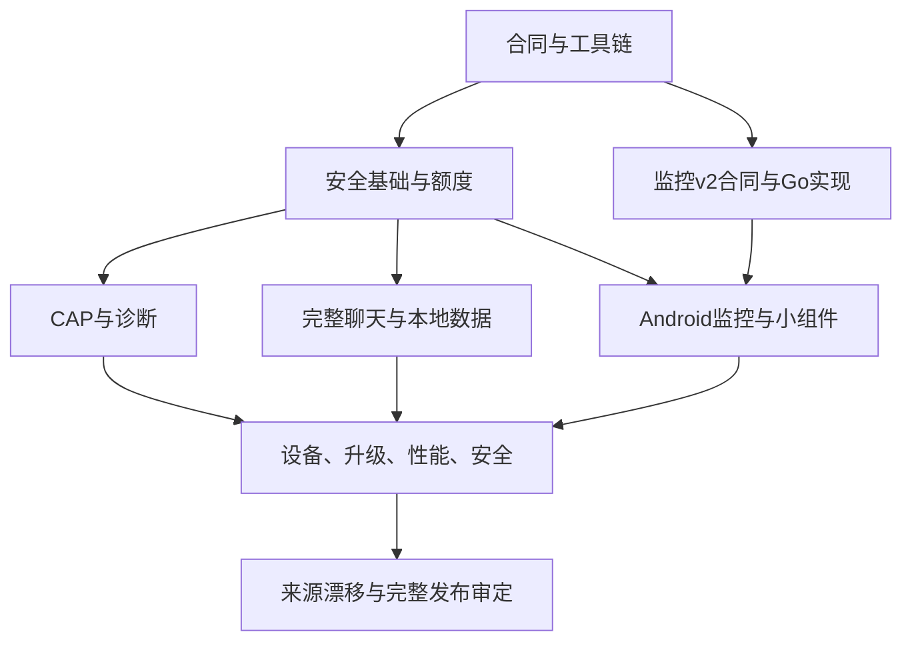

# 07 · 交付路径、依赖与可领取任务

任务卡由 tools/render_indexes.py 从 [work-items.json](manifests/work-items.json) 生成。每个工作项是可追踪的交付责任；L 级任务应拆成数个依赖明确的 PR，不要求一个巨大 PR。当前所有任务尚未启动、尚未分派。

## 1. 执行顺序

先冻结协议与工具链，再做安全连接—账号—额度的完整纵向链。CAP、聊天、服务端监控在基础接口稳定后并行；系统展示与真实推送随后汇合。最后覆盖真实系统故障、升级、性能、安全与源版本漂移，达到完整发布条件。

以下图是职责汇合关系，具体阻塞依赖以任务卡 depends_on 为准。M2/M3/M4 是能力里程碑，并不意味着整个团队必须串行做完一个阶段才开始下一个。

## 2. 里程碑及退出条件

| 阶段 | 可演示成果 | 必须通过的退出条件 |
| --- | --- | --- |
| M0 | 固定合同与最小真实原生工程 | 源SHA/差异决策、可构建版本矩阵、SDK/LAN/SSE/后台/渲染预研结果 |
| M1 | 安装后连接、查询全部额度、详情与恢复 | 凭据事务、身份代际、限流、取消、未知与旧数据保真；手机和宽窗口可走完整链 |
| M2 | CAP四栏目与全部诊断设置 | 独立资源窗口、分页预算、统计完整性、只读边界 |
| M3 | 完整聊天工作区 | 消息所有操作、五搜索、记忆/技能、双协议、推理、富文本/HTML、存储与后台收尾全部可用 |
| M4 | 完整监控与系统展示 | Go v1兼容/v2、真实FCM、token轮换、停止/恢复、小组件与隐私 |
| M5 | 可审阅Release候选 | 声明设备矩阵、升级恢复、性能预算、安全审阅、签名与运营材料 |
| M6 | 对固定源版本的完整移植 | 93项必需能力证据、34项必需任务verified、最终SHA/二进制/服务版本一致 |

## 3. 团队与 agent 并行边界

| 工作流 | 主要任务 | 独占接口/共享协调 |
| --- | --- | --- |
| 基础与合同 | 001–008、031 | ConnectionContext、RequestCoordinator、错误、版本catalog；修改须通知受影响负责人 |
| CAP与原生工作区 | 009–011、028 | CAPResourceState、时间窗口、设计token；不复制数据客户端 |
| 聊天与数据 | 012–021 | Room schema、附件事务、GenerationCoordinator；schema按序迁移 |
| 监控服务与客户端 | 022–027 | v2 wire合同、Go兼容、push adapter；跨仓库合同版本先锁定 |
| 质量与发布整合 | 029–034 | 集成环境、证据、Release产物、来源漂移；审阅者不得仅为实现者自证 |

1–2名开发者时依上述路径逐段推进；3–4名可在共同合同稳定后分别负责CAP、聊天、监控，保留一名整合负责人。agent数量不等于交付速度：同一schema、版本catalog或状态机只设一个变更协调者。

技术调查可在依赖未verified时先做；正式集成不能把未合并的接口猜测当成已经稳定。若使用临时mock，PR必须标明其覆盖边界，mock绿灯不能关闭真实服务或设备门禁。

## 4. 工作量与排期方法

S/M/L 是相对复杂度，不是承诺日期：S为局部可审阅成果，M涉及数个组件或一个系统边界，L涉及并发、协议、迁移或跨平台链。开工后先完成M0和额度纵向链，再根据实际吞吐、真实设备与服务可用性估算日历时间。

预留明确的集成、升级、安全与返工容量；不能把38个任务平均分天。FCM配置、真机、签名材料和服务部署环境是交付前置，取得时间应登记负责人和日期。缺失时可推进合成合同，但相应门禁保持blocked。

## 5. 工作项索引

| ID | 任务 | 阶段 | 大小 | 依赖 | 仓库 |
| --- | --- | --- | --- | --- | --- |
| TASK-001 | 冻结源行为、裁决差异并建立语言无关契约 | M0 | M | 无 | Android |
| TASK-002 | 验证SDK37与原生依赖组合 | M0 | M | TASK-001 | Android |
| TASK-003 | 模块化工程、CI与原生导航骨架 | M1 | M | TASK-002 | Android |
| TASK-004 | 安全凭据、偏好与备份基础 | M1 | M | TASK-002 | Android |
| TASK-005 | 安全HTTP、地址和共享请求协调器 | M1 | L | TASK-001, TASK-002 | Android |
| TASK-006 | 连接事务与本机恢复 | M1 | M | TASK-003, TASK-004, TASK-005 | Android |
| TASK-007 | 完整额度解析与身份缓存 | M1 | L | TASK-001, TASK-005 | Android |
| TASK-008 | 额度纵向功能完成 | M1 | M | TASK-006, TASK-007 | Android |
| TASK-009 | CAP协议、统计和窗口核心 | M2 | L | TASK-001, TASK-005, TASK-006 | Android |
| TASK-010 | CAP完整工作区与明细 | M2 | L | TASK-003, TASK-009 | Android |
| TASK-011 | 账号诊断、偏好与隐私展示 | M2 | M | TASK-004, TASK-006, TASK-008 | Android |
| TASK-012 | Room、附件和持久草稿基础 | M3 | L | TASK-003, TASK-004 | Android |
| TASK-013 | 聊天凭据、模型与设置 | M3 | M | TASK-005, TASK-006, TASK-012 | Android |
| TASK-014 | 双协议SSE与计费安全传输 | M3 | L | TASK-001, TASK-005 | Android |
| TASK-015 | 推理档位兼容策略 | M3 | M | TASK-013, TASK-014 | Android |
| TASK-016 | 生成、续写和跨服务状态机 | M3 | L | TASK-012, TASK-013, TASK-014, TASK-015 | Android |
| TASK-017 | 完整原生聊天界面与富文本 | M3 | L | TASK-003, TASK-012, TASK-016 | Android |
| TASK-018 | 五搜索提供方与来源快照 | M3 | M | TASK-013, TASK-016 | Android |
| TASK-019 | 记忆、技能、指令和标题 | M3 | M | TASK-013, TASK-016, TASK-017 | Android |
| TASK-020 | 静态HTML安全预览 | M3 | M | TASK-017 | Android |
| TASK-021 | 聊天后台收尾、通知与持久化恢复 | M3 | M | TASK-004, TASK-016, TASK-017 | Android |
| TASK-022 | 跨平台监控新协议与迁移规范 | M4 | M | TASK-001 | Android |
| TASK-023 | Go监控核心协议与兼容层实现 | M4 | L | TASK-022 | Go源仓库 |
| TASK-024 | Android监控客户端与恢复工作区 | M4 | L | TASK-004, TASK-005, TASK-006, TASK-022 | Android |
| TASK-025 | Go FCM投递适配 | M4 | M | TASK-023 | Go源仓库 |
| TASK-026 | Android推送与通知生命周期 | M4 | M | TASK-021, TASK-024, TASK-025 | Android |
| TASK-027 | 原生小组件与系统展示 | M4 | M | TASK-008, TASK-011, TASK-024 | Android |
| TASK-028 | 完整自适应与无障碍验收 | M5 | L | TASK-010, TASK-011, TASK-017, TASK-018, TASK-019, TASK-020, TASK-021, TASK-026, TASK-027 | Android |
| TASK-029 | 系统故障与升级集成矩阵 | M5 | L | TASK-008, TASK-010, TASK-011, TASK-017, TASK-018, TASK-019, TASK-020, TASK-021, TASK-026, TASK-027 | Android |
| TASK-030 | 性能预算与Release优化 | M5 | M | TASK-028, TASK-029 | Android |
| TASK-031 | 独立安全与契约审阅 | M5 | M | TASK-023, TASK-025, TASK-028, TASK-029 | Android |
| TASK-032 | 签名、分发、升级和运营文档 | M5 | M | TASK-029, TASK-030, TASK-031 | Android |
| TASK-033 | 完整移植发布审定与交付 | M6 | S | TASK-001, TASK-002, TASK-003, TASK-004, TASK-005, TASK-006, TASK-007, TASK-008, TASK-009, TASK-010, TASK-011, TASK-012, TASK-013, TASK-014, TASK-015, TASK-016, TASK-017, TASK-018, TASK-019, TASK-020, TASK-021, TASK-022, TASK-023, TASK-024, TASK-025, TASK-026, TASK-027, TASK-028, TASK-029, TASK-030, TASK-031, TASK-032, TASK-034 | Android |
| TASK-034 | 发布前源版本漂移复核 | M5 | M | TASK-001, TASK-028, TASK-029 | Android |
| TASK-035 | 可选：跨平台历史交换 | EXTRA | L | TASK-012, TASK-016, TASK-032 | Android |
| TASK-036 | 可选：持久聊天任务服务 | EXTRA | L | TASK-016, TASK-021, TASK-031 | Android |
| TASK-037 | 可选：无GMS实时推送扩展 | EXTRA | L | TASK-025, TASK-026 | Android |
| TASK-038 | 可选：跨设备同步 | EXTRA | L | TASK-012, TASK-031 | Android |

## 6. 可直接领取的任务卡

### TASK-001 · 冻结源行为、裁决差异并建立语言无关契约

- 仓库：rinmashiro0529/cpa-quota-Android；阶段：M0；相对规模：M；发布必需。
- 前置：无。
- 能力：CON-01, CON-02, CON-03, CON-04, CON-05, CON-06, CON-07, CON-08, QUO-01, QUO-02, QUO-03, QUO-04, QUO-05, QUO-06, QUO-07, QUO-08, QUO-09, QUO-10, CAP-01, CAP-02, CAP-03, CAP-04, CAP-05, CAP-06, CAP-07, CAP-08, CAP-09, CAP-10, CAP-11, CAP-12, CAP-13, CHA-01, CHA-02, CHA-03, CHA-04, CHA-05, CHA-06, CHA-07, CHA-08, CHA-09, CHA-10, CHA-11, CHA-12, CHA-13, CHA-14, CHA-15, CHA-16, CHA-17, CHA-18, CHA-19, CHA-20, CHA-21, CHA-22, CHA-23, CHA-24, MON-01, MON-02, MON-03, MON-04, MON-05, MON-06, MON-07, MON-08, MON-09, MON-10, MON-11, MON-12。
- 状态：not_started；负责人：未分派；证据：尚无。

**交付物**

- source manifest复核及变更摄取规则
- 协议fixtures与差异ADR
- 先固定空数值、Unicode、single-flight取消语义

**验收**

- 每个关键边界有输入和预期输出，尚无实现的样本不标passed
- PR33/34与main分开记录；没有自动吸收未合并行为
- 来源路径、SHA和协议版本可定位

关闭此工作项前，按 [证据模板](manifests/evidence-template.json) 记录代码提交、命令、环境、结果及独立审阅，不以企划本身作为实现证据。

### TASK-002 · 验证SDK37与原生依赖组合

- 仓库：rinmashiro0529/cpa-quota-Android；阶段：M0；相对规模：M；发布必需。
- 前置：TASK-001。
- 能力：AND-01, AND-06。
- 状态：not_started；负责人：未分派；证据：尚无。

**交付物**

- 固定JDK/Gradle/AGP/Kotlin/Compose/Nav3/Adaptive/Room/Hilt矩阵
- 最小API26与37安装运行证据
- LAN、SSE取消、后台边界和富文本技术spike

**验收**

- 至少实际编译安装到下限与当前模拟器
- 官方文档不一致有明确处理，未采用alpha示例为默认
- 输出版本锁和可重建命令，未通过项阻断相关任务

关闭此工作项前，按 [证据模板](manifests/evidence-template.json) 记录代码提交、命令、环境、结果及独立审阅，不以企划本身作为实现证据。

### TASK-003 · 模块化工程、CI与原生导航骨架

- 仓库：rinmashiro0529/cpa-quota-Android；阶段：M1；相对规模：M；发布必需。
- 前置：TASK-002。
- 能力：NAV-01, NAV-02, NAV-03, AND-02。
- 状态：not_started；负责人：未分派；证据：尚无。

**交付物**

- 独立仓库根app/core/data/feature结构
- 五工作区返回栈与fake数据预览
- 轻量PR CI与分层检查

**验收**

- 旋转/resize/深链不重建业务会话
- required check缺失或未执行不视为通过
- 单元与仪器测试入口可运行；无真实凭据

关闭此工作项前，按 [证据模板](manifests/evidence-template.json) 记录代码提交、命令、环境、结果及独立审阅，不以企划本身作为实现证据。

### TASK-004 · 安全凭据、偏好与备份基础

- 仓库：rinmashiro0529/cpa-quota-Android；阶段：M1；相对规模：M；发布必需。
- 前置：TASK-002。
- 能力：CON-03, CON-06, AND-04, AND-05。
- 状态：not_started；负责人：未分派；证据：尚无。

**交付物**

- SecretStore接口和Keystore实现
- DataStore非秘密偏好
- 备份排除及密钥失效恢复

**验收**

- 保存/删除/损坏/恢复缺钥均注入失败测试
- 无明文回退，不因凭据失效清空聊天
- Worker和saved-state只传ID不传密钥

关闭此工作项前，按 [证据模板](manifests/evidence-template.json) 记录代码提交、命令、环境、结果及独立审阅，不以企划本身作为实现证据。

### TASK-005 · 安全HTTP、地址和共享请求协调器

- 仓库：rinmashiro0529/cpa-quota-Android；阶段：M1；相对规模：L；发布必需。
- 前置：TASK-001, TASK-002。
- 能力：CON-01, CON-07, CON-08。
- 状态：not_started；负责人：未分派；证据：尚无。

**交付物**

- ServerEndpoint/错误模型/Transport
- 管理、CAP、聊天、搜索隔离策略
- Clock与限流、取消、大小预算

**验收**

- 路径前缀、重定向、编码路径、实际超限与TLS负例通过
- 管理401/403和429跨入口共享，单账号上游错误独立
- single-flight取消合同明确且无缓存绕过

关闭此工作项前，按 [证据模板](manifests/evidence-template.json) 记录代码提交、命令、环境、结果及独立审阅，不以企划本身作为实现证据。

### TASK-006 · 连接事务与本机恢复

- 仓库：rinmashiro0529/cpa-quota-Android；阶段：M1；相对规模：M；发布必需。
- 前置：TASK-003, TASK-004, TASK-005。
- 能力：CON-02, CON-03, CON-04, CON-05, CON-06, NAV-02, AND-06。
- 状态：not_started；负责人：未分派；证据：尚无。

**交付物**

- 候选/已接受上下文和generation
- remember/temporary流程
- LAN权限与重连/忘记交互

**验收**

- 关闭、返回、深链与换凭据期间迟到结果不能提交
- 旧连接在新候选失败时可用
- Android17 LAN拒绝/撤销有专门状态

关闭此工作项前，按 [证据模板](manifests/evidence-template.json) 记录代码提交、命令、环境、结果及独立审阅，不以企划本身作为实现证据。

### TASK-007 · 完整额度解析与身份缓存

- 仓库：rinmashiro0529/cpa-quota-Android；阶段：M1；相对规模：L；发布必需。
- 前置：TASK-001, TASK-005。
- 能力：QUO-01, QUO-03, QUO-04, QUO-05, QUO-10。
- 状态：not_started；负责人：未分派；证据：尚无。

**交付物**

- 所有现有读取器、wire decoder和黄金样本
- Observation/ReadingOutcome分离
- 身份代际与缓存合并规则

**验收**

- 零/null/缺字段/无数值/超额/金额单位全部覆盖
- Swift/Go存在差异的样本按ADR处理并保留差异证据
- 禁用/删除/身份变更不能回填旧快照

关闭此工作项前，按 [证据模板](manifests/evidence-template.json) 记录代码提交、命令、环境、结果及独立审阅，不以企划本身作为实现证据。

### TASK-008 · 额度纵向功能完成

- 仓库：rinmashiro0529/cpa-quota-Android；阶段：M1；相对规模：M；发布必需。
- 前置：TASK-006, TASK-007。
- 能力：QUO-01, QUO-02, QUO-03, QUO-04, QUO-05, QUO-06, QUO-07, QUO-08, QUO-09, QUO-10。
- 状态：not_started；负责人：未分派；证据：尚无。

**交付物**

- 渐进总览、搜索筛选、详情
- 批量和单账号刷新/取消/冷却
- 手机与宽窗口真实页面

**验收**

- 1/10/50合成账号端到端路径通过
- 首个结果无需等最慢账号；失败保留原观察时间
- 总览和详情未知/过期/限制状态一致

关闭此工作项前，按 [证据模板](manifests/evidence-template.json) 记录代码提交、命令、环境、结果及独立审阅，不以企划本身作为实现证据。

### TASK-009 · CAP协议、统计和窗口核心

- 仓库：rinmashiro0529/cpa-quota-Android；阶段：M2；相对规模：L；发布必需。
- 前置：TASK-001, TASK-005, TASK-006。
- 能力：CAP-01, CAP-02, CAP-03, CAP-04, CAP-05, CAP-06, CAP-07, CAP-08, CAP-09, CAP-10, CAP-11, CAP-12, CAP-13。
- 状态：not_started；负责人：未分派；证据：尚无。

**交付物**

- 匿名/管理资源客户端与独立资源状态
- UTC时间窗和完整性预算
- 统计加权规则

**验收**

- 全部CAP端点按其认证约定测试
- 月范围只读取指定服务端摘要，不扫描无界历史
- 单区失败/重试和分页预算有确定性测试

关闭此工作项前，按 [证据模板](manifests/evidence-template.json) 记录代码提交、命令、环境、结果及独立审阅，不以企划本身作为实现证据。

### TASK-010 · CAP完整工作区与明细

- 仓库：rinmashiro0529/cpa-quota-Android；阶段：M2；相对规模：L；发布必需。
- 前置：TASK-003, TASK-009。
- 能力：CAP-01, CAP-02, CAP-03, CAP-04, CAP-05, CAP-06, CAP-07, CAP-08, CAP-09, CAP-10, CAP-11, CAP-12, CAP-13。
- 状态：not_started；负责人：未分派；证据：尚无。

**交付物**

- 模型概览、趋势分组费用、请求记录、管理统计
- 完整表格、分页、缺价和来源说明
- 范围面板与当前栏目刷新

**验收**

- 所有主线入口逐项截图与交互验证
- 切范围不自动请求，失败重试不偷换窗口
- 图表不可绘点保留表格、错误不清空成功区域

关闭此工作项前，按 [证据模板](manifests/evidence-template.json) 记录代码提交、命令、环境、结果及独立审阅，不以企划本身作为实现证据。

### TASK-011 · 账号诊断、偏好与隐私展示

- 仓库：rinmashiro0529/cpa-quota-Android；阶段：M2；相对规模：M；发布必需。
- 前置：TASK-004, TASK-006, TASK-008。
- 能力：DIA-01, DIA-02, DIA-03, DIA-04, DIA-05, DIA-06。
- 状态：not_started；负责人：未分派；证据：尚无。

**交付物**

- 完整账号诊断
- 主题/已用剩余/邮箱隐私
- 一致错误修复入口

**验收**

- 数据错误层次不会互相误归因
- 设置跨重启保留且秘密不混入偏好
- 不新增对上游账号的写操作

关闭此工作项前，按 [证据模板](manifests/evidence-template.json) 记录代码提交、命令、环境、结果及独立审阅，不以企划本身作为实现证据。

### TASK-012 · Room、附件和持久草稿基础

- 仓库：rinmashiro0529/cpa-quota-Android；阶段：M3；相对规模：L；发布必需。
- 前置：TASK-003, TASK-004。
- 能力：CHA-04, CHA-05, CHA-06, CHA-22, AND-09。
- 状态：not_started；负责人：未分派；证据：尚无。

**交付物**

- schema及非破坏迁移测试
- AttachmentStore staged/committed恢复
- 摘要分页与草稿存储

**验收**

- 进程中断文件/数据库边界不产生悬空引用或误删
- 低存储、损坏索引、schema升级有可恢复路径
- 列表/搜索不解码所有附件
- 中文子串、代码片段、%/_字面值、组合字符及大小写搜索遵守冻结合同；搜索不加载图片，索引不得改变原可见结果

关闭此工作项前，按 [证据模板](manifests/evidence-template.json) 记录代码提交、命令、环境、结果及独立审阅，不以企划本身作为实现证据。

### TASK-013 · 聊天凭据、模型与设置

- 仓库：rinmashiro0529/cpa-quota-Android；阶段：M3；相对规模：M；发布必需。
- 前置：TASK-005, TASK-006, TASK-012。
- 能力：CHA-01, CHA-02, CHA-03, CHA-08, CHA-12。
- 状态：not_started；负责人：未分派；证据：尚无。

**交付物**

- 推理Key发现与手动管理
- 模型目录和新会话策略
- 设置加载失败与credential revision

**验收**

- 404/501接口不可用兼容只在已验证的端点分支发生；401/403不作同类回退
- 模型/Key迟到响应不污染新连接
- 设置读取失败不能开启原本关闭的记忆或上传范围

关闭此工作项前，按 [证据模板](manifests/evidence-template.json) 记录代码提交、命令、环境、结果及独立审阅，不以企划本身作为实现证据。

### TASK-014 · 双协议SSE与计费安全传输

- 仓库：rinmashiro0529/cpa-quota-Android；阶段：M3；相对规模：L；发布必需。
- 前置：TASK-001, TASK-005。
- 能力：CHA-07。
- 状态：not_started；负责人：未分派；证据：尚无。

**交付物**

- Chat Completions/Anthropic adapter
- SSE scanner与终止判定
- 明确兼容拒绝的有界回退与禁止透明POST重试和请求计数夹具

**验收**

- 任意UTF-8分块/CRLF/末尾事件/伪message_stop通过
- 200坏响应与部分结果后断流不重复推理POST
- 请求大小、空闲/整体超时、取消及response关闭验证
- 请求派发后首个输出前超时/断网，保持unknown/interrupted，HTTP客户端不得透明重试POST；用真实请求计数夹具验证

关闭此工作项前，按 [证据模板](manifests/evidence-template.json) 记录代码提交、命令、环境、结果及独立审阅，不以企划本身作为实现证据。

### TASK-015 · 推理档位兼容策略

- 仓库：rinmashiro0529/cpa-quota-Android；阶段：M3；相对规模：M；发布必需。
- 前置：TASK-013, TASK-014。
- 能力：CHA-08, CHA-03。
- 状态：not_started；负责人：未分派；证据：尚无。

**交付物**

- 纯Kotlin ReasoningPolicy
- 代际化capability cache
- 实际应用档位呈现模型

**验收**

- 所有现有档位和允许回退阶梯有fixture
- 有界重试且错误类别不会互相误判
- 旧generation拒绝不能污染新缓存

关闭此工作项前，按 [证据模板](manifests/evidence-template.json) 记录代码提交、命令、环境、结果及独立审阅，不以企划本身作为实现证据。

### TASK-016 · 生成、续写和跨服务状态机

- 仓库：rinmashiro0529/cpa-quota-Android；阶段：M3；相对规模：L；发布必需。
- 前置：TASK-012, TASK-013, TASK-014, TASK-015。
- 能力：CHA-09, CHA-10, CHA-21, CHA-22, CHA-23, CHA-24。
- 状态：not_started；负责人：未分派；证据：尚无。

**交付物**

- GenerationCoordinator/attempt模型
- PromptBuilder与历史边界
- 单写入序列和删除屏障

**验收**

- 取消/续写/编辑/换服务/删除交错无复活和串会话
- 确认绑定目的地与凭据revision
- 恢复streaming为interrupted且无自动重发，用量累计正确

关闭此工作项前，按 [证据模板](manifests/evidence-template.json) 记录代码提交、命令、环境、结果及独立审阅，不以企划本身作为实现证据。

### TASK-017 · 完整原生聊天界面与富文本

- 仓库：rinmashiro0529/cpa-quota-Android；阶段：M3；相对规模：L；发布必需。
- 前置：TASK-003, TASK-012, TASK-016。
- 能力：CHA-04, CHA-05, CHA-06, CHA-10, CHA-11, CHA-17, CHA-23。
- 状态：not_started；负责人：未分派；证据：尚无。

**交付物**

- 会话CRUD和搜索
- 原生消息、推理折叠、输入框与图片
- 代码/表格/公式/复制/滚动行为

**验收**

- 所有源端用户动作有可达入口
- 长流式只更新必要内容，向上阅读不被拉回
- 中文/emoji/代码围栏/大字体与附件选择恢复通过

关闭此工作项前，按 [证据模板](manifests/evidence-template.json) 记录代码提交、命令、环境、结果及独立审阅，不以企划本身作为实现证据。

### TASK-018 · 五搜索提供方与来源快照

- 仓库：rinmashiro0529/cpa-quota-Android；阶段：M3；相对规模：M；发布必需。
- 前置：TASK-013, TASK-016。
- 能力：CHA-13, CHA-14。
- 状态：not_started；负责人：未分派；证据：尚无。

**交付物**

- 全部源搜索adapter
- 独立SecretStore作用域与URL安全
- searchCompleted/query/source冻结

**验收**

- 未配置/失败/零结果/中断区分
- 搜索停止/删会话后不继续发推理请求
- 结果标为不可信来源，密钥不随redirect或诊断泄漏

关闭此工作项前，按 [证据模板](manifests/evidence-template.json) 记录代码提交、命令、环境、结果及独立审阅，不以企划本身作为实现证据。

### TASK-019 · 记忆、技能、指令和标题

- 仓库：rinmashiro0529/cpa-quota-Android；阶段：M3；相对规模：M；发布必需。
- 前置：TASK-013, TASK-016, TASK-017。
- 能力：CHA-11, CHA-12, CHA-15, CHA-16, CHA-19。
- 状态：not_started；负责人：未分派；证据：尚无。

**交付物**

- 记忆CRUD/置顶/开关
- slash技能CRUD与重复校验
- 全局/会话指令和自动标题

**验收**

- 技能修改不改变原轮重试请求
- 全局作用域明确，跨服务器发送有对应提示
- 标题迟到不覆盖用户输入，失败不破坏回复

关闭此工作项前，按 [证据模板](manifests/evidence-template.json) 记录代码提交、命令、环境、结果及独立审阅，不以企划本身作为实现证据。

### TASK-020 · 静态HTML安全预览

- 仓库：rinmashiro0529/cpa-quota-Android；阶段：M3；相对规模：M；发布必需。
- 前置：TASK-017。
- 能力：CHA-18。
- 状态：not_started；负责人：未分派；证据：尚无。

**交付物**

- 静态预览、源码展示和复制
- WebView隔离配置与资源拦截
- loopback正/负对照夹具

**验收**

- 脚本/网络/外部CSS/CSS URL/iframe/file/content/intent/桥/弹窗负例通过；允许的内联样式有正对照
- 正对照能访问测试server，排除测试本身断网假通过
- 主聊天和预览不共享凭据/cookie/WebView全局状态

关闭此工作项前，按 [证据模板](manifests/evidence-template.json) 记录代码提交、命令、环境、结果及独立审阅，不以企划本身作为实现证据。

### TASK-021 · 聊天后台收尾、通知与持久化恢复

- 仓库：rinmashiro0529/cpa-quota-Android；阶段：M3；相对规模：M；发布必需。
- 前置：TASK-004, TASK-016, TASK-017。
- 能力：CHA-20, CHA-22, CHA-24, AND-03, AND-07。
- 状态：not_started；负责人：未分派；证据：尚无。

**交付物**

- 最多30秒best-effort后台策略
- checkpoint及安全本地完成通知
- 低存储/强杀/任务切换恢复

**验收**

- 退后台立即提交checkpoint；到期取消并保留状态
- 系统提前回收后恢复为interrupted，不宣称保证运行30秒
- 通知拒绝不阻塞保存；payload仅含固定完成文案及不透明会话/完成ID，不含标题、正文、邮箱或服务地址

关闭此工作项前，按 [证据模板](manifests/evidence-template.json) 记录代码提交、命令、环境、结果及独立审阅，不以企划本身作为实现证据。

### TASK-022 · 跨平台监控新协议与迁移规范

- 仓库：rinmashiro0529/cpa-quota-Android；阶段：M4；相对规模：M；发布必需。
- 前置：TASK-001。
- 能力：MON-01, MON-02, MON-03, MON-04, MON-05, MON-06, MON-07, MON-08, MON-09, MON-10, MON-11, MON-12。
- 状态：not_started；负责人：未分派；证据：尚无。

**交付物**

- 版本化订阅/端点/capabilities合同
- 错误表/幂等/CAS/墓碑与生命周期fixture
- Android/iOS旧v1升级兼容矩阵

**验收**

- 字段、认证、状态转移和未知结果可独立实现
- FCM token按opaque case-sensitive处理
- 保留v1终态和授权边界；不偷加TTL

关闭此工作项前，按 [证据模板](manifests/evidence-template.json) 记录代码提交、命令、环境、结果及独立审阅，不以企划本身作为实现证据。

### TASK-023 · Go监控核心协议与兼容层实现

- 仓库：rinmashiro0529/cpa-quota-ios；阶段：M4；相对规模：L；发布必需。
- 前置：TASK-022。
- 能力：MON-08, MON-02, MON-03, MON-04, MON-05, MON-06, MON-07, MON-09, MON-10, MON-11。
- 状态：not_started；负责人：未分派；证据：尚无。

**交付物**

- 另仓PR实现新协议和v1 adapter
- 存储schema迁移与恢复
- 旧客户端契约回归

**验收**

- Go单测/race/vet和v1合成回归通过
- 重启/磁盘错误/迟到注册/跨身份重放不破坏终态
- 只交付代码与部署文档，生产升级需明确授权
- 服务端endpoint registry实现CAS与revision校验；旧token投递回调不能撤销新端点

关闭此工作项前，按 [证据模板](manifests/evidence-template.json) 记录代码提交、命令、环境、结果及独立审阅，不以企划本身作为实现证据。

### TASK-024 · Android监控客户端与恢复工作区

- 仓库：rinmashiro0529/cpa-quota-Android；阶段：M4；相对规模：L；发布必需。
- 前置：TASK-004, TASK-005, TASK-006, TASK-022。
- 能力：MON-01, MON-02, MON-03, MON-04, MON-05, MON-06, MON-07, MON-08, MON-09, MON-10, MON-11。
- 状态：not_started；负责人：未分派；证据：尚无。

**交付物**

- 监控独立身份、连接与source选择
- 订阅控制、快照、旧记录与诊断
- 新旧服务能力降级

**验收**

- source/账号/租约/容量与完整停止恢复入口均可达
- 无新服务时不伪造已创建；原会话可核对停止
- 操作unknown保持恢复记录，关显示不误报停服务

关闭此工作项前，按 [证据模板](manifests/evidence-template.json) 记录代码提交、命令、环境、结果及独立审阅，不以企划本身作为实现证据。

### TASK-025 · Go FCM投递适配

- 仓库：rinmashiro0529/cpa-quota-ios；阶段：M4；相对规模：M；发布必需。
- 前置：TASK-023。
- 能力：MON-08, MON-12。
- 状态：not_started；负责人：未分派；证据：尚无。

**交付物**

- 投递provider接口与FCM实现
- 令牌轮换、失效分类和安全payload
- 合成provider/真实测试环境流程

**验收**

- 不透明token不变大小写、不按APNs hex校验
- 平台接受与设备送达分开；失败退避有界
- 服务账号私钥只服务端，日志不含敏感payload

关闭此工作项前，按 [证据模板](manifests/evidence-template.json) 记录代码提交、命令、环境、结果及独立审阅，不以企划本身作为实现证据。

### TASK-026 · Android推送与通知生命周期

- 仓库：rinmashiro0529/cpa-quota-Android；阶段：M4；相对规模：M；发布必需。
- 前置：TASK-021, TASK-024, TASK-025。
- 能力：MON-08, MON-12, NAV-03, AND-07。
- 状态：not_started；负责人：未分派；证据：尚无。

**交付物**

- PushProvider与FCM客户端
- token注册/注销/轮换/通知channel
- 无GMS能力页和可延迟更新

**验收**

- 授权GMS测试设备真实送达并可冷启动定位
- token轮换、重复/乱序/过期事件按revision处理
- 无GMS/拒绝通知不会崩溃或显示推送已就绪

关闭此工作项前，按 [证据模板](manifests/evidence-template.json) 记录代码提交、命令、环境、结果及独立审阅，不以企划本身作为实现证据。

### TASK-027 · 原生小组件与系统展示

- 仓库：rinmashiro0529/cpa-quota-Android；阶段：M4；相对规模：M；发布必需。
- 前置：TASK-008, TASK-011, TASK-024。
- 能力：WID-01, WID-02, WID-03, WID-04, WID-05, WID-06。
- 状态：not_started；负责人：未分派；证据：尚无。

**交付物**

- Glance小组件与配置
- 按来源/账号opaque ID的最小安全投影
- 过期/关闭/切来源清理

**验收**

- 默认关闭，失效选择不切到别人账号
- 尺寸改变、大字体、时间标记和深链可用
- Android17位图预算、隐私遮罩和停止展示验证

关闭此工作项前，按 [证据模板](manifests/evidence-template.json) 记录代码提交、命令、环境、结果及独立审阅，不以企划本身作为实现证据。

### TASK-028 · 完整自适应与无障碍验收

- 仓库：rinmashiro0529/cpa-quota-Android；阶段：M5；相对规模：L；发布必需。
- 前置：TASK-010, TASK-011, TASK-017, TASK-018, TASK-019, TASK-020, TASK-021, TASK-026, TASK-027。
- 能力：NAV-01, NAV-03, AND-02, AND-08。
- 状态：not_started；负责人：未分派；证据：尚无。

**交付物**

- 五工作区折叠/横屏/分屏/IME完善
- TalkBack及大字体检查
- 状态与错误中文统一

**验收**

- 展开/旋转/折回连续流程保留同一会话与草稿
- 最后一项可达、焦点和返回顺序正确
- 截图附设备、OS、SHA与窗口证据，不以iOS模拟器代替

关闭此工作项前，按 [证据模板](manifests/evidence-template.json) 记录代码提交、命令、环境、结果及独立审阅，不以企划本身作为实现证据。

### TASK-029 · 系统故障与升级集成矩阵

- 仓库：rinmashiro0529/cpa-quota-Android；阶段：M5；相对规模：L；发布必需。
- 前置：TASK-008, TASK-010, TASK-011, TASK-017, TASK-018, TASK-019, TASK-020, TASK-021, TASK-026, TASK-027。
- 能力：AND-03, AND-04, AND-05, AND-06, AND-07, AND-09。
- 状态：not_started；负责人：未分派；证据：尚无。

**交付物**

- min26/33/36/37分层矩阵
- 网络/权限/Doze/存储/恢复故障注入
- 安装升级和数据库迁移集成

**验收**

- 系统kill、Activity recreation、force-stop分别报告
- 真实本地持久内容恢复且无重复计费动作
- 未执行/环境阻塞不会改写成pass

关闭此工作项前，按 [证据模板](manifests/evidence-template.json) 记录代码提交、命令、环境、结果及独立审阅，不以企划本身作为实现证据。

### TASK-030 · 性能预算与Release优化

- 仓库：rinmashiro0529/cpa-quota-Android；阶段：M5；相对规模：M；发布必需。
- 前置：TASK-028, TASK-029。
- 能力：AND-10, CHA-17。
- 状态：not_started；负责人：未分派；证据：尚无。

**交付物**

- 固定真机/数据集/测量协议
- Macrobenchmark、profile与渲染/IO优化
- 可比较基线和回归门槛

**验收**

- 记录冷启动、长会话、帧、RSS、磁盘写放大与取消延迟
- 外部模型延迟和本地耗时分开
- 没有用模拟器或Debug性能冒充Release真机结果

关闭此工作项前，按 [证据模板](manifests/evidence-template.json) 记录代码提交、命令、环境、结果及独立审阅，不以企划本身作为实现证据。

### TASK-031 · 独立安全与契约审阅

- 仓库：rinmashiro0529/cpa-quota-Android；阶段：M5；相对规模：M；发布必需。
- 前置：TASK-023, TASK-025, TASK-028, TASK-029。
- 能力：CON-07, CON-08, CHA-18, CHA-21, MON-10, AND-04, AND-05。
- 状态：not_started；负责人：未分派；证据：尚无。

**交付物**

- 威胁边界与发布范围复核
- 源码/依赖/历史/附件扫描
- 认证、重放、敏感显示和WebView负例报告

**验收**

- 当前候选的严重和高风险问题为0或保持发布阻断
- 审阅者独立于实现者；不能用文档自证运行安全
- 契约差异有ADR且未删关键断言

关闭此工作项前，按 [证据模板](manifests/evidence-template.json) 记录代码提交、命令、环境、结果及独立审阅，不以企划本身作为实现证据。

### TASK-032 · 签名、分发、升级和运营文档

- 仓库：rinmashiro0529/cpa-quota-Android；阶段：M5；相对规模：M；发布必需。
- 前置：TASK-029, TASK-030, TASK-031。
- 能力：AND-11。
- 状态：not_started；负责人：未分派；证据：尚无。

**交付物**

- 固定包身份、Release APK/AAB与签名流程
- 最小权限/隐私/三方声明
- 升级/暂停发布/前向修复手册

**验收**

- release安装与覆盖升级保留数据
- 签名材料不入repo或产物日志
- 不支持数据库降级时明确前向修复；不承诺旧APK可直接回滚

关闭此工作项前，按 [证据模板](manifests/evidence-template.json) 记录代码提交、命令、环境、结果及独立审阅，不以企划本身作为实现证据。

### TASK-033 · 完整移植发布审定与交付

- 仓库：rinmashiro0529/cpa-quota-Android；阶段：M6；相对规模：S；发布必需。
- 前置：TASK-001, TASK-002, TASK-003, TASK-004, TASK-005, TASK-006, TASK-007, TASK-008, TASK-009, TASK-010, TASK-011, TASK-012, TASK-013, TASK-014, TASK-015, TASK-016, TASK-017, TASK-018, TASK-019, TASK-020, TASK-021, TASK-022, TASK-023, TASK-024, TASK-025, TASK-026, TASK-027, TASK-028, TASK-029, TASK-030, TASK-031, TASK-032, TASK-034。
- 能力：NAV-01, NAV-02, NAV-03, CON-01, CON-02, CON-03, CON-04, CON-05, CON-06, CON-07, CON-08, QUO-01, QUO-02, QUO-03, QUO-04, QUO-05, QUO-06, QUO-07, QUO-08, QUO-09, QUO-10, CAP-01, CAP-02, CAP-03, CAP-04, CAP-05, CAP-06, CAP-07, CAP-08, CAP-09, CAP-10, CAP-11, CAP-12, CAP-13, DIA-01, DIA-02, DIA-03, DIA-04, DIA-05, DIA-06, CHA-01, CHA-02, CHA-03, CHA-04, CHA-05, CHA-06, CHA-07, CHA-08, CHA-09, CHA-10, CHA-11, CHA-12, CHA-13, CHA-14, CHA-15, CHA-16, CHA-17, CHA-18, CHA-19, CHA-20, CHA-21, CHA-22, CHA-23, CHA-24, MON-01, MON-02, MON-03, MON-04, MON-05, MON-06, MON-07, MON-08, MON-09, MON-10, MON-11, MON-12, WID-01, WID-02, WID-03, WID-04, WID-05, WID-06, AND-01, AND-02, AND-03, AND-04, AND-05, AND-06, AND-07, AND-08, AND-09, AND-10, AND-11。
- 状态：not_started；负责人：未分派；证据：尚无。

**交付物**

- 93项必需能力与证据总账
- 精确SHA/依赖锁/服务版本/设备矩阵
- 维护者可审阅发布包

**验收**

- 所有必需任务完成、关键门禁通过、开放缺口真实列出
- GMS完整能力与无GMS降级声明准确；未以core-only/MVP冒充完全移植
- 用户选择基准与发布授权分别有记录，自动化不擅自发布或部署

关闭此工作项前，按 [证据模板](manifests/evidence-template.json) 记录代码提交、命令、环境、结果及独立审阅，不以企划本身作为实现证据。

### TASK-034 · 发布前源版本漂移复核

- 仓库：rinmashiro0529/cpa-quota-Android；阶段：M5；相对规模：M；发布必需。
- 前置：TASK-001, TASK-028, TASK-029。
- 能力：NAV-01, NAV-02, NAV-03, CON-01, CON-02, CON-03, CON-04, CON-05, CON-06, CON-07, CON-08, QUO-01, QUO-02, QUO-03, QUO-04, QUO-05, QUO-06, QUO-07, QUO-08, QUO-09, QUO-10, CAP-01, CAP-02, CAP-03, CAP-04, CAP-05, CAP-06, CAP-07, CAP-08, CAP-09, CAP-10, CAP-11, CAP-12, CAP-13, DIA-01, DIA-02, DIA-03, DIA-04, DIA-05, DIA-06, CHA-01, CHA-02, CHA-03, CHA-04, CHA-05, CHA-06, CHA-07, CHA-08, CHA-09, CHA-10, CHA-11, CHA-12, CHA-13, CHA-14, CHA-15, CHA-16, CHA-17, CHA-18, CHA-19, CHA-20, CHA-21, CHA-22, CHA-23, CHA-24, MON-01, MON-02, MON-03, MON-04, MON-05, MON-06, MON-07, MON-08, MON-09, MON-10, MON-11, MON-12, WID-01, WID-02, WID-03, WID-04, WID-05, WID-06。
- 状态：not_started；负责人：未分派；证据：尚无。

**交付物**

- 冻结SHA到发布时iOS main差异报告
- 新功能/安全修复/行为变化摄取决策
- 新版parity台账或明确版本化声明

**验收**

- 未合并PR不能自动变基线
- 新P0安全修复作为发布阻断摄取，其余变更有显式范围决定
- 发布只声称对已验证源SHA完整，不笼统说对最新版本完整

关闭此工作项前，按 [证据模板](manifests/evidence-template.json) 记录代码提交、命令、环境、结果及独立审阅，不以企划本身作为实现证据。

### TASK-035 · 可选：跨平台历史交换

- 仓库：rinmashiro0529/cpa-quota-Android；阶段：EXTRA；相对规模：L；可选增强。
- 前置：TASK-012, TASK-016, TASK-032。
- 能力：ENH-01。
- 状态：not_started；负责人：未分派；证据：尚无。

**交付物**

- 版本化manifest+正文+附件交换格式
- iOS导出配套任务需单独授权
- Android导入与恢复

**验收**

- 默认无密钥，schema/压缩大小/路径穿越/重复ID有边界测试
- 源端无导出能力时不声称迁移已可用
- 未完成不影响冻结基线原功能完整性的结论

关闭此工作项前，按 [证据模板](manifests/evidence-template.json) 记录代码提交、命令、环境、结果及独立审阅，不以企划本身作为实现证据。

### TASK-036 · 可选：持久聊天任务服务

- 仓库：rinmashiro0529/cpa-quota-Android；阶段：EXTRA；相对规模：L；可选增强。
- 前置：TASK-016, TASK-021, TASK-031。
- 能力：ENH-02。
- 状态：not_started；负责人：未分派；证据：尚无。

**交付物**

- server job/status/cancel/recovery协议
- 未知结果与计费边界
- 独立隐私/运维设计

**验收**

- 额外服务经明确授权，不把QuotaMonitor直接当聊天代理
- 基线外功能独立版本和验收
- 任务状态不能冒充模型服务幂等保证

关闭此工作项前，按 [证据模板](manifests/evidence-template.json) 记录代码提交、命令、环境、结果及独立审阅，不以企划本身作为实现证据。

### TASK-037 · 可选：无GMS实时推送扩展

- 仓库：rinmashiro0529/cpa-quota-Android；阶段：EXTRA；相对规模：L；可选增强。
- 前置：TASK-025, TASK-026。
- 能力：ENH-03。
- 状态：not_started；负责人：未分派；证据：尚无。

**交付物**

- 经需求确认的厂商provider
- 分发/账号/隐私约束
- 指定真机送达矩阵

**验收**

- 每个厂商独立证据，不承诺全部Android通用保活
- 不影响无该SDK设备核心功能
- 未实现不宣传无GMS后台通知全等价

关闭此工作项前，按 [证据模板](manifests/evidence-template.json) 记录代码提交、命令、环境、结果及独立审阅，不以企划本身作为实现证据。

### TASK-038 · 可选：跨设备同步

- 仓库：rinmashiro0529/cpa-quota-Android；阶段：EXTRA；相对规模：L；可选增强。
- 前置：TASK-012, TASK-031。
- 能力：ENH-04。
- 状态：not_started；负责人：未分派；证据：尚无。

**交付物**

- 身份与加密边界
- 冲突合并、删除与附件同步
- 单独产品决策

**验收**

- 新增云服务/收集范围另获授权
- 本地模式无强制注册
- 与本次移植发布分开

关闭此工作项前，按 [证据模板](manifests/evidence-template.json) 记录代码提交、命令、环境、结果及独立审阅，不以企划本身作为实现证据。

## 7. 每项任务如何关闭

状态只能按 not_started → in_progress → in_review → verified 推进；发现阻塞可进入blocked并记录解除条件。文档编写完成不能使产品任务verified。通过代码审阅但缺设备/服务证据时仍保持in_review或blocked。已验证后发生影响性变更必须重新打开对应门禁。

当前企划被选择后，任务负责人使用 [task-brief.md](templates/task-brief.md) 建立本次范围；PR使用 [implementation-pr.md](templates/implementation-pr.md)。不必一次创建全部远端Issue，先领取依赖满足的工作项。
